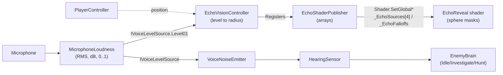

# Architecture

This page explains how Echo Protocol is put together and, more importantly, why I made the main decisions the way I did.
I'm building the game on my own with a deadline, so my rule is: take the shortest route that is still clean enough to extend later.

## Core loop: voice to light



### 1. `MicrophoneLoudness` (`Scripts/Audio`)
1. It starts a 1 second looping `AudioClip` from the microphone (16 kHz).
2. Each frame it reads only the **newest 512 samples** (about 32 ms) and computes the RMS.
3. It converts the RMS to decibels (`20 * log10(rms)`) and maps the decibels to a 0-1 level. By default `MicrophoneCalibrator` does the mapping, so the game learns each microphone. With *Auto Calibrate* off it maps `[silenceDb, screamDb]` to `[0, 1]`.
4. It smooths the level with a **fast attack and a slow release**. Shouts register at once and the light fades out naturally.
5. It sorts the level into `Silent / Whisper / Talk / Scream` with **hysteresis**, so the state does not flicker around a threshold.

I use decibels instead of raw RMS because we hear loudness on a logarithmic scale. With raw RMS, whispers are almost invisible and screams saturate.

`MicrophoneCalibrator` is plain maths with no Unity objects, so it is easy to test. It tracks the noise floor (down at once, up slowly) and how loudly the player talks. Normal speech always maps to the same level, whatever the gain of the microphone.

The microphone is a resource shared by the whole process, and every player prefab (remote avatars included) carries a `MicrophoneLoudness`.
So capture is **reference counted**: the first user starts the device and the last one to be disabled stops it.
This way a remote avatar that spawns and is disabled right away never kills the local player's recording.
When the 1 second ring buffer wraps, the previous reading is held for that frame instead of dropping to silence.

### 2. `EchoVisionController` (`Scripts/Echo`)
It maps `Level01` to a radius with an editable `AnimationCurve`, so I can tune the feel without touching code.
It applies a noise gate and smooths growth and decay separately. A voice sensitivity multiplier makes the echo easier or harder to trigger without changing what the monster hears.
It runs in `LateUpdate`, after movement, so the sphere uses the final position of the player.
In multiplayer the owner computes the radius and writes it to a FishNet `SyncVar`, and remote clients smooth towards it.
Each instance registers with `EchoShaderPublisher`, which collects up to 4 players and sets the global shader arrays.

### 3. `EchoReveal` shader (`Shaders/EchoReveal.shader`)
A URP unlit HLSL shader. For every pixel it does roughly this:
```
mask = 1 - smoothstep(radius - falloff, radius + 0.01, distance(worldPos, origin))
ring = mask * (1 - mask) * 4                 // a glow that peaks at the edge of the sphere
color = pattern * tint * mask + edgeColor * ring     // plus a pulse, a rim light and emission
```
The surface pattern is procedural and projected in **world space** (a simple triplanar), so scaled primitives do not stretch it. The patterns and the rest of the look are described in [Visual design](VISUAL_DESIGN.md).

## Key design decisions

| Decision | Alternatives I considered | Why |
|---|---|---|
| `IVoiceLevelSource` interface | Consumers read `MicrophoneLoudness` directly | A voice chat plugin will want to own the microphone later, and remote players provide a networked value. Changing the source must not touch the consumers. |
| Global shader values | Per-material properties | One call lights every material in the scene, with no bookkeeping per object. |
| Hand-written HLSL shader | Shader Graph | It is easy to diff, easy to review in a pull request and easier to extend (an array of origins). |
| `CharacterController` | Rigidbody controller | It is stable and simple. For ragdolls the controller is disabled and rigidbodies take over. See [Player ragdoll](RAGDOLL.md). |
| `AnimationCurve` for loudness to radius | A hard-coded formula | Faster iteration on game feel. |
| Editor builder for the sandbox scene | A hand-built scene | It is reproducible: anyone can regenerate the test scene from code. |
| `INoiseSource` and `NoiseRegistry` | Enemies search the scene for players | Enemies depend on an abstraction, so footsteps, physics impacts or networked voice become audible without changing the AI. A registry also avoids `Find*` calls every frame. See [Enemy AI](ENEMY_AI.md). |
| `HearingSensor` separate from `EnemyBrain` | One big enemy script | What the enemy heard and what it decides to do can be tuned, tested and replaced on their own. |
| Enum and `switch` state machine | State classes or a behaviour tree | Three states do not justify that much code. Extracting a state class later is a mechanical refactor. |
| Runtime `NavMeshBootstrap` fallback | Trusting the baked NavMesh | An enemy standing on missing ground fails silently, so the fallback lets the scene fix itself. |

## Gameplay modules

On top of the voice-to-light core, the match loop is built from small, separate modules (the design is in [Living relics](LIVING_RELICS_DESIGN.md)):

| Module | Folder | Role |
|---|---|---|
| `IInteractable` and `PlayerInteraction` | `Interaction/`, `Player/` | One interaction contract (`E`) for relics, altar sockets and future doors and levers. |
| `RelicCarryable` | `Interaction/` | Networked pick-up, drop and throw physics. It drops automatically when the carrier ragdolls. |
| `RelicBrain`, `RelicPersonality`, `RelicVoiceSynthesizer`, `RelicDialogueUI` | `Relics/` | Reactions (sprint, microphone, monster, flight), the dialogue lines, procedural voices and the HUD and world bubbles. A relic is also an `INoiseSource`, so the monster hears it without any AI change. |
| `AltarReceptacle` and `AltarSocket` | `Altar/` | Objective tracking. Filling all the sockets triggers the symphony climax. |
| `EscapePortal` and `GameExtractionManager` | `Extraction/` | The extraction countdown, the victory and defeat screens and the restart. |
| `GameSettings`, `SettingsManager` and `SettingsPanel` | `Settings/`, `UI/` | The player's options. `GameSettings` is plain data (limits, defaults, saving through an `ISettingsStore`, so tests use a memory store). `SettingsManager` applies changes at once and raises `Changed`; the microphone, the echo and the audio listen to it, and the mouse look reads it every frame. |
| `MatchMenu` and `LobbyMenuUI` | `UI/`, `Networking/UI/` | `MatchMenu` is the state of the `Esc` menu (closed, main, settings, controls) and owns the cursor while it is open. It lives in the core assembly, so the player controller can use it, and `LobbyMenuUI` in the networking assembly draws it, because only it can call *Leave Match*. |

## Multiplayer model (Fish-Net)

The principle: **enemies run only on the server, and each client owns its own player.** It is implemented, and the details are in [Networking](NETWORKING.md).

| Concern | Authority | Notes |
|---|---|---|
| Player movement | Owning client | Client-authoritative transform sync is enough for a comedy co-op game. |
| Microphone level | Owning client to server | `Level01` is replicated through `EchoVisionController` (a quantized radius and the loudness) at about 10-20 Hz. Audio is not sent through this channel. |
| Enemy AI and hearing | Server | The server decides Idle, Investigate or Hunt from the levels and positions it receives. |
| Ragdolls | Owning client, hips synced | Syncing only the root keeps bandwidth low. The limbs are cosmetic. |
| Relic dialogue | Server to observers | The server picks the line (`ObserversRpc`) and clients only show it. |
| Voice chat | Voice plugin | The plugin handles proximity. Planned. |

## Conventions

- Scripts live in `Assets/Scripts/<Module>/`. Network-specific code is kept in `Networking/` so the core systems stay testable offline. Gameplay classes still derive from `NetworkBehaviour`, and `OfflineSandboxGuard` makes them run when the scene has no `NetworkManager`.
- Avoid `??` and `?.` on `UnityEngine.Object` references. They bypass Unity's overloaded `==` for destroyed objects, so use explicit `== null` checks.
- Private serialized fields (`[SerializeField] private float _moveSpeed`).
- Modern Unity 6 APIs (`FindFirstObjectByType`, Input System callbacks and assets).
- One responsibility per script.
