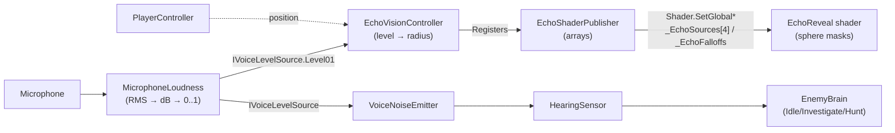

# Architecture

This document explains how Echo Protocol is structured and, more importantly, **why** key decisions were made.
The project is built solo under a tight deadline, so the guiding principle is: *the shortest route that is still clean enough to extend*.

## Core Loop: Voice → Light



### 1. `MicrophoneLoudness` (`Scripts/Audio`)
1. Starts a 1-second looping `AudioClip` from the microphone (16 kHz).
2. Each frame reads only the **newest 512 samples** (~32 ms) and computes RMS.
3. Converts RMS to decibels (`20·log10(rms)`) and remaps `[silenceDb, screamDb]` to `[0, 1]`.
4. Applies **fast attack / slow release** smoothing: shouts register instantly, light fades naturally.
5. Classifies the level into `Silent / Whisper / Talk / Scream` with **hysteresis** to avoid flickering at thresholds.

Why dB and not raw RMS? Human loudness perception is logarithmic; raw RMS makes whispers nearly invisible and screams saturate.

The microphone device is a process-wide resource, and every player prefab (including remote avatars) carries a `MicrophoneLoudness`.
Capture is therefore **reference counted**: the device is started by the first user and only stopped when the last one is disabled,
so a remote avatar spawning (and being disabled right away) never kills the local player's recording.
When the 1-second ring buffer wraps, the previous reading is held for that frame instead of dropping to silence.

### 2. `EchoVisionController` (`Scripts/Echo`)
Maps `Level01` to a radius through an editable `AnimationCurve` (designers tune feel without touching code),
applies a noise gate, and smooths growth/decay separately. It runs in `LateUpdate`, after movement, so the sphere uses the player's final position.
In multiplayer the owner computes the radius and writes it to a FishNet `SyncVar`; remote clients smooth towards it.
Instances register with `EchoShaderPublisher`, which aggregates up to 4 players and sets the global shader arrays.

### 3. `EchoReveal` shader (`Shaders/EchoReveal.shader`)
URP unlit HLSL. Per pixel:
```
mask = 1 - smoothstep(radius - falloff, radius + 0.01, distance(worldPos, origin))
ring = mask * (1 - mask) * 4                 // glow that peaks at the sphere edge
color = texture * tint * mask + edgeColor * ring
```
Textures are projected in **world space** (triplanar-lite), so scaled primitives do not stretch the texture.

## Key Design Decisions

| Decision | Alternatives considered | Rationale |
|---|---|---|
| `IVoiceLevelSource` interface | Consumers read `MicrophoneLoudness` directly | The voice-chat plugin will want to own the microphone later, and remote players will provide a networked value. Swapping the source must not touch consumers. |
| Global shader values | Per-material properties | One call lights every material in the scene; no per-object bookkeeping. Will become a vector array for multiple players. |
| Hand-written HLSL shader | Shader Graph | Diff-friendly, reviewable in pull requests, and easier to extend (array of origins). |
| `CharacterController` | Rigidbody controller | Stable and simple. For ragdolls, the controller is disabled and rigidbodies take over. See [Player Ragdoll](RAGDOLL.md). |
| `AnimationCurve` for loudness → radius | Hard-coded formula | Faster iteration on game feel. |
| Editor builder for the sandbox scene | Hand-built scene | Reproducible: anyone can regenerate the test scene from code. |
| `INoiseSource` + `NoiseRegistry` | Enemies search the scene for players | Enemies depend on an abstraction, so footsteps, physics impacts or networked voice become audible with zero AI changes. A registry avoids `Find*` calls every frame. See [Enemy AI](ENEMY_AI.md). |
| `HearingSensor` separate from `EnemyBrain` | One big enemy script | Perception (what was heard) and decision (what to do) can be tuned, tested and replaced independently. |
| Enum + `switch` state machine | State pattern classes / behaviour tree | Three states do not justify the boilerplate; extracting a state class later is a mechanical refactor. |
| Runtime `NavMeshBootstrap` fallback | Trust the baked NavMesh | An enemy standing on missing ground fails silently; the fallback makes the scene self-healing. |

## Gameplay Loop Modules

On top of the voice → light core, the match loop is built from small, separate modules (design in [Living Relics](LIVING_RELICS_DESIGN.md)):

| Module | Folder | Role |
|---|---|---|
| `IInteractable` + `PlayerInteraction` | `Interaction/`, `Player/` | One interaction contract (`E`) for relics, altar sockets and future doors/levers. |
| `RelicCarryable` | `Interaction/` | Networked pick-up/drop/throw physics; drops automatically when the carrier ragdolls. |
| `RelicBrain` + `RelicPersonality` + `RelicVoiceSynthesizer` + `RelicDialogueUI` | `Relics/` | Reactions (sprint, mic, monster, flight), dialogue repository, procedural voices, HUD/world bubbles. Registers as an `INoiseSource`, so the monster hears relics with zero AI changes. |
| `AltarReceptacle` + `AltarSocket` | `Altar/` | Objective tracking; completing all sockets triggers the symphony climax. |
| `EscapePortal` + `GameExtractionManager` | `Extraction/` | Extraction countdown, victory/defeat screens and restart. |

## Multiplayer Model (Fish-Net)

Principle: **enemies run only on the server; each client owns its own player.** (Implemented, see [Networking](NETWORKING.md).)

| Concern | Authority | Notes |
|---|---|---|
| Player movement | Owning client | Client-authoritative transform sync is enough for a comedy co-op game. |
| Microphone level | Owning client → server | `Level01` is replicated through `EchoVisionController` (quantized radius + loudness), ~10–20 Hz. Audio is *not* sent through this channel. |
| Enemy AI & perception | Server | Server decides Idle / Investigate / Hunt from received levels and positions. |
| Ragdolls | Owning client, hips synced | Syncing only the root keeps bandwidth low; limbs are cosmetic. |
| Relic dialogue | Server → observers | The server picks the line (`ObserversRpc`); clients only render it. |
| Voice chat | Voice plugin | Proximity attenuation handled by the plugin. *(Planned.)* |

## Conventions

- Scripts live in `Assets/Scripts/<Module>/`; networking-specific code is isolated in `Networking/` so core systems stay testable offline
  (gameplay classes still derive from `NetworkBehaviour`; `OfflineSandboxGuard` makes them run when the scene has no `NetworkManager`).
- Avoid `??` / `?.` on `UnityEngine.Object` references: they bypass Unity's overloaded `==` for destroyed objects. Use explicit `== null` checks.
- Private serialized fields (`[SerializeField] private float _moveSpeed`).
- Modern Unity 6 APIs (`FindFirstObjectByType`, Input System callbacks/assets).
- One responsibility per script.

