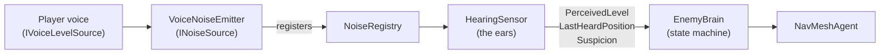
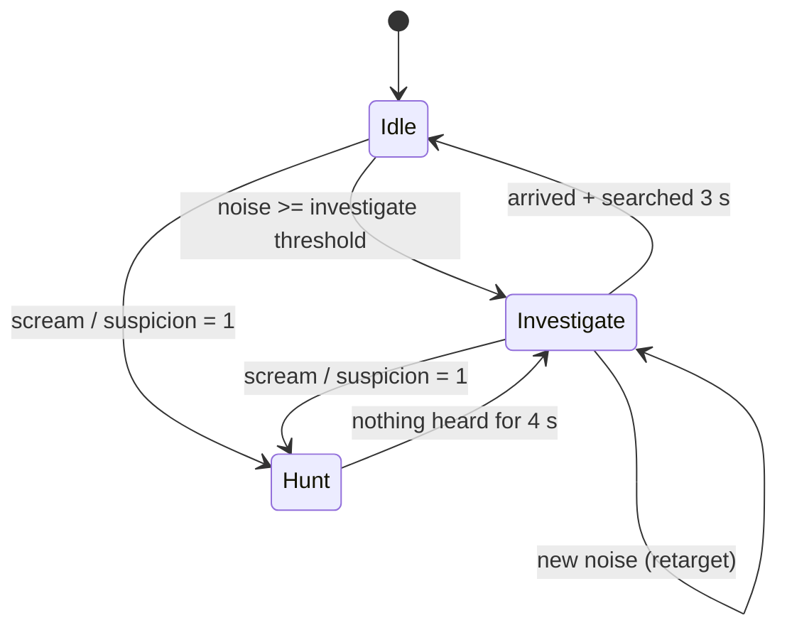

# Enemy AI: blind hunters

The enemies in Echo Protocol have **no eyes and perfect ears**. They never "see" a player. They only react to how loud the player is and how far away they are.
This page describes the model, the state machine and how to tune it.

## Overview



I split the responsibilities so each piece can be tested and replaced on its own:

| Script | Folder | Responsibility |
|---|---|---|
| `INoiseSource` | `Core` | The contract for anything that can be heard. |
| `NoiseRegistry` | `Core` | A static list of the active noise sources (no scene searches every frame). |
| `VoiceNoiseEmitter` | `Audio` | Exposes a player's voice level as a noise source. |
| `HearingSensor` | `Enemies` | Applies the distance falloff, finds the loudest source and builds suspicion. It **decides nothing**. |
| `EnemyBrain` | `Enemies` | The state machine and the movement. It **hears nothing directly**. |
| `NavMeshBootstrap` | `Core` | Builds the NavMesh at runtime if the baked one is missing. |

## Hearing model

For every noise source, every 0.1 s:

```
attenuation = 1 - clamp01(distance / maxHearingRange)
perceived   = noiseLevel01 * attenuation
```

The enemy keeps the **loudest** `perceived` value. Two thresholds then classify it:

| Perceived level | Meaning |
|---|---|
| `>= investigateThreshold` (0.2) | It noticed something and it is worth checking. |
| `>= huntThreshold` (0.55) | Loud and close (a scream), so it hunts immediately. |

**Suspicion** covers the "constant noise" rule from my design notes. While the enemy hears something worth investigating, suspicion rises by `perceived * suspicionGain` per second, and in silence it decays. At `1.0` the enemy hunts, even if the noise was never a scream. So chatting loudly next to a monster is a bad idea.

An example with the default values (`maxHearingRange = 40 m`):

| Player | Level | Heard (investigate) up to | Instant hunt up to |
|---|---|---|---|
| Whisper | about 0.25 | about 8 m | never |
| Talking | about 0.65 | about 28 m | about 6 m |
| Scream | 1.0 | about 32 m | about 18 m |

## State machine



| State | Behaviour | Speed |
|---|---|---|
| **Idle** | Picks random reachable points around its home and pauses 2 to 5 s between them. | 1.2 m/s |
| **Investigate** | Walks to the last heard position and picks a new target if the noise moves. When it arrives it turns on the spot for 3 s and looks around. | 2.5 m/s |
| **Hunt** | Sprints to the noise. It keeps following while it hears anything, and after 4 s of silence it checks the last position (Investigate). | 6 m/s |

Leaving **Hunt** resets the suspicion, so the enemy does not go straight back into a hunt.

### Catching players
The enemy is blind but not numb. Any player within `catchDistance`, in **any** state, triggers `OnPlayerCaught(Transform)` (with a 3 s cooldown). Players who are ragdolling, or still immune after getting up, are skipped.
A relic that is being carried counts as its carrier. `EnemyCatchReaction` listens to this event and starts the [ragdoll](RAGDOLL.md).

After a catch the enemy gloats for 3 s (`Stun`), then it is **sated** for 7 s: it walks about 14 m away from its victim, ignores every sound and catches nobody. Before this, the victim's own landing thud called it straight back, it waited on top of them and caught them again the moment their grace time ended, so a player could never get away. Now the victim has time to get up and slip away; an enraged enemy goes back to the chase when the 7 s are over.

`catchDistance` is 2.2 m by default in `EnemyBrain` (and on the sandbox enemy) and 1.6 m on the `Enemy_Blind` prefab used in multiplayer.
The check is horizontal, so height is ignored.

### Enrage (the extraction climax)
When the altar symphony starts, `EnemyBrain.EnrageAll(speed)` forces every enemy into a permanent **Hunt** at 7 m/s. This only happens on the server, and remote clients ignore it.
An enraged enemy never loses its target. If it hears nothing, it keeps walking towards the **nearest player**, so staying silent no longer saves you.

## Events (extension points)

```csharp
brain.OnStateChanged += (from, to) => { /* audio sting, music, UI */ };
brain.OnPlayerCaught += player => { /* ragdoll, respawn, score */ };
```

## Tuning

Every value is exposed in the Inspector (`HearingSensor` and `EnemyBrain`). Some quick recipes:

| I want | Change |
|---|---|
| A more forgiving game | Raise `investigateThreshold` and lower `maxHearingRange`. |
| Panic-inducing hunts | Raise `huntSpeed` and lower `loseTargetTime`. |
| To punish chatty players | Raise `suspicionGain`. |
| Smarter-feeling enemies | Lower `updateInterval` (more frequent hearing scans). |

Select an enemy in the Scene view to see its gizmos: the red sphere is the hearing range, the green one is the wander area and the yellow one is the current target.

## Multiplayer notes

The brain and the sensor run **only on the server**. On clients the `NavMeshAgent`, `HearingSensor` and brain are disabled, and the `NetworkTransform` drives the position. Each player has a `VoiceNoiseEmitter` fed by `EchoVisionController`, which exposes the loudness replicated from that client. Relics are `INoiseSource`s too (talking, panicking, flying). Because the AI only depends on `INoiseSource`, none of this needed AI changes.

## Known limitations

- Sound goes through walls. There is no occlusion yet.
- The wander points of an enemy are limited to the NavMesh areas it can reach from where it stands.
- There is only one enemy type, and no coordination between enemies.
- The server does not know when a *remote* player is ragdolling or immune, because that state lives on the owning client. So it can catch and stun a remote player again during their ragdoll or grace time. The fix is to replicate a "ragdolled" flag.
