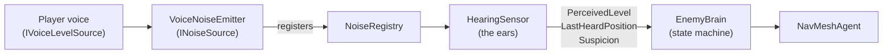
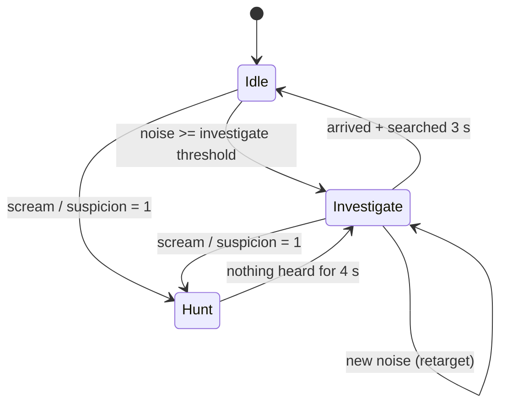

# Enemy AI: Blind Hunters

Enemies in Echo Protocol have **no eyes and perfect ears**. They never "see" players: they only react to how loud
a player is and how far away they are. This document describes the model, the state machine and how to tune it.

## Overview



Responsibilities are split so each piece can be tested and replaced on its own:

| Script | Folder | Responsibility |
|---|---|---|
| `INoiseSource` | `Core` | Contract for anything that can be heard. |
| `NoiseRegistry` | `Core` | Static list of active noise sources (no per-frame scene searches). |
| `VoiceNoiseEmitter` | `Audio` | Exposes a player's voice level as a noise source. |
| `HearingSensor` | `Enemies` | Applies distance attenuation, finds the loudest source, builds suspicion. **Decides nothing.** |
| `EnemyBrain` | `Enemies` | State machine and movement. **Hears nothing directly.** |
| `NavMeshBootstrap` | `Core` | Builds the NavMesh at runtime if the baked one is missing. |

## Hearing model

For each noise source, every 0.1 s:

```
attenuation = 1 - clamp01(distance / maxHearingRange)
perceived   = noiseLevel01 * attenuation
```

The enemy keeps the **loudest** `perceived` value. Two thresholds then classify it:

| Perceived level | Meaning |
|---|---|
| `>= investigateThreshold` (0.2) | Noticed: worth checking out. |
| `>= huntThreshold` (0.55) | Loud and close (a scream): hunt immediately. |

**Suspicion** covers the "constant noise" rule from the design document. While the enemy can hear something
investigable, suspicion rises by `perceived * suspicionGain` per second; in silence it decays. At `1.0` the enemy hunts,
even if the noise was never a scream. So chatting loudly next to a monster is a bad idea.

Example with default values (`maxHearingRange = 40 m`):

| Player | Level | Heard (investigate) up to | Instant hunt up to |
|---|---|---|---|
| Whisper | ~0.25 | ~8 m | never |
| Talking | ~0.65 | ~28 m | ~6 m |
| Scream | 1.0 | ~32 m | ~18 m |

## State machine



| State | Behaviour | Speed |
|---|---|---|
| **Idle** | Picks random reachable points around its home, pauses 2–5 s between them. | 1.2 m/s |
| **Investigate** | Walks to the last heard position, retargets if the noise moves, then turns on the spot for 3 s looking around. | 2.5 m/s |
| **Hunt** | Sprints to the noise. Keeps following while it hears anything; after 4 s of silence it checks the last position (Investigate). | 6 m/s |

Leaving **Hunt** resets suspicion, so the enemy does not instantly re-enter the hunt.

### Catching players
The enemy is blind but not numb: any player within `catchDistance`, in **any** state, triggers
`OnPlayerCaught(Transform)` (with a 3 s cooldown). Players that are ragdolling or still immune after getting up are skipped.
A relic being carried counts as its carrier. `EnemyCatchReaction` subscribes to this event and starts the [ragdoll](RAGDOLL.md).

`catchDistance` is 2.2 m by default in `EnemyBrain` (and in the sandbox scene's enemy) and 1.6 m on the `Enemy_Blind` prefab used in multiplayer.
The check is horizontal (height is ignored).

### Enrage (extraction climax)
When the altar symphony starts, `EnemyBrain.EnrageAll(speed)` forces every enemy into a permanent **Hunt** at 7 m/s (server only; remote clients ignore it).
An enraged enemy never loses its target: if it hears nothing it keeps walking toward the **nearest player**, so staying silent no longer saves you.

## Events (extension points)

```csharp
brain.OnStateChanged += (from, to) => { /* audio sting, music, UI */ };
brain.OnPlayerCaught += player => { /* ragdoll, respawn, score */ };
```

## Tuning

All values are exposed in the Inspector (`HearingSensor` and `EnemyBrain`). Quick recipes:

| I want… | Change |
|---|---|
| More forgiving game | Raise `investigateThreshold`, lower `maxHearingRange`. |
| Panic-inducing hunts | Raise `huntSpeed`, lower `loseTargetTime`. |
| Punish chatty players | Raise `suspicionGain`. |
| Smarter-feeling enemies | Lower `updateInterval` (more frequent hearing scans). |

Select an enemy in the Scene view to see gizmos: red sphere = hearing range, green = wander area, yellow = current target.

## Multiplayer notes

The brain and sensor run **only on the server**; on clients the `NavMeshAgent`, `HearingSensor` and brain are disabled and the
`NetworkTransform` drives the position. Each player has a `VoiceNoiseEmitter` fed by `EchoVisionController`, which exposes the loudness
replicated from that client. Relics are `INoiseSource`s too (talking, panicking, flying). Because the AI only depends on `INoiseSource`, no AI code changes.

## Known limitations

- Sound travels through walls (no occlusion yet).
- Enemy wander points are limited to NavMesh areas reachable from its position.
- A single enemy type; no group coordination.
- The server does not know when a *remote* player is ragdolling or immune (that state lives on the owning client),
  so it can re-catch and re-stun a remote player during their ragdoll/grace time. Fix: replicate a "ragdolled" flag.
