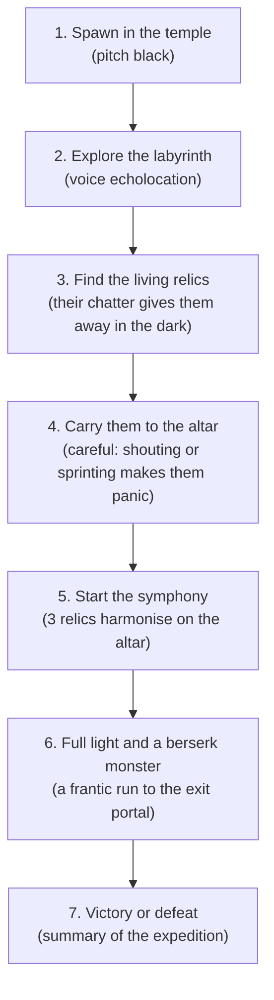
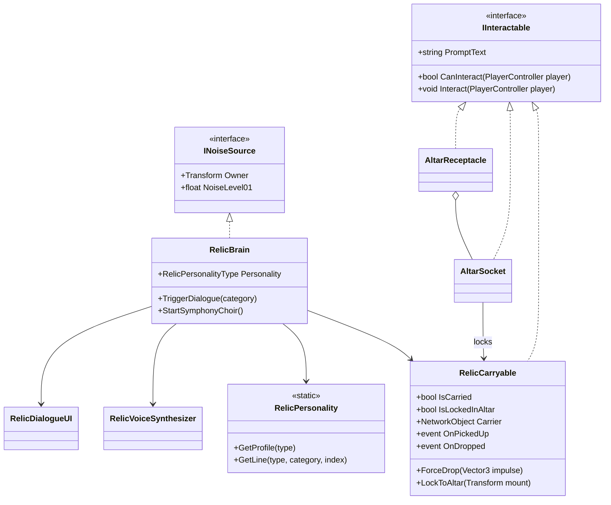

# Living relics and the game loop

This page describes the technical design of the living relics, the game loop around them, and the plan I'm following to turn the technical prototype into a complete, funny multiplayer game before November 1st. For each part I say what is **implemented** and what is still **planned**.

---

## 1. The game loop: "The Screaming Relics"

### Design rules
1. **Your voice is more than a flashlight, it is also a way to interact.** If you scream into the microphone, the relic you carry reacts and roasts you.
2. **A relic is a walking hazard.** When it chatters, complains or flies through the air, it reports noise to `NoiseRegistry`, which alerts the blind monster and attracts it.
3. **A relic is sensitive.** It must be carried whispering and passed around, or it cries until the team soothes it with the human echo ritual. See [Team noise and relic rituals](TEAM_NOISE_AND_RITUALS.md).
4. **The symphony is the climax.** When all 3 relics are on the central altar, they sing an absurd choir that floods the cavern with light for good, unlocks the exit portal and sends the monster into a berserk chase.

---

## 2. How a living relic works (implemented)

### The components
1. **`RelicCarryable.cs`** (`NetworkBehaviour`, `IInteractable`)
   - `E` picks the relic up (the server checks the distance) and `E` or `G` drops it. The carrier is a `SyncVar<NetworkObject>`. While the relic is carried, its Rigidbody is kinematic, its collider is off and it sticks to the carrier's `CarrySocket`.
   - If the carrier is knocked into a ragdoll (`PlayerRagdoll.OnRagdollStarted`), `PlayerInteraction` calls `ForceDrop` and the relic is thrown outwards with physics momentum.
   - `LockToAltar` permanently parents the relic to an altar socket.
2. **`RelicBrain.cs`** (`NetworkBehaviour`, `INoiseSource`)
   - There is no state enum. Timers and thresholds raise *dialogue categories* (`RelicDialogueCategory`), and flight detection raises the rest.

   | Category | Trigger |
   |---|---|
   | `IdleSleep` | Left alone on the ground. It murmurs from time to time, which helps players find it by sound. |
   | `Pickup` / `NormalDrop` | Picked up, or dropped gently. |
   | `CarryChatter` | Random chatter about every 16 s while it is carried. |
   | `Sprinting` | The carrier sprints faster than 4 m/s for 2.2 s. |
   | `MicReaction` | The carrier's voice `Level01` is at least 0.38 for 0.7 s (this also makes noise at 0.6). |
   | `MonsterNear` | A monster that is not idle comes within 14 m (15 s cooldown). |
   | `FlyingScream` / `LandedImpact` | Speed of at least 11.5 m/s after a throw or a ragdoll launch, and the impact when it lands. |
   | `AltarPlaced` | Docked into an altar socket. |

   - **Noise it reports to `NoiseRegistry`:** talking 0.08, mic reaction 0.60, impact 0.70, flying scream 0.95 and the symphony choir 0.60 (continuous). The blind monster's `HearingSensor` hears all of it.
   - On the server, the brain picks the line and sends it to every peer (`ObserversRpc`).
3. **`RelicPersonality.cs`** is a static store of profiles (name, title, colours, base pitch) and the jokes for each archetype and category.
4. **`RelicVoiceSynthesizer.cs`** makes the audio at runtime with no external assets: speech blips, a looping Doppler scream while the relic is in the air, impact bonks and the altar choir.
5. **`RelicDialogueUI.cs`** shows a screen-space dialogue card with typewriter text, and a floating bubble above the relic in the world.

*Planned, not done yet:* glowing eyes that change colour with the relic's mood (`RelicVisuals`): soft blue, pulsing yellow, strobing red.

Debug keys: `T` cycles the personality archetype, `Y` forces a random roast and `M` mutes or unmutes all the relics.

---

## 3. The personalities and their voices

There are four archetypes today (`RelicPersonalityType`). The sandbox spawns the first three, and the level spawns one relic for each shrine.

| Archetype | Name and title | Personality | Voice |
|---|---|---|---|
| `SarcasticCritic` | **Obsidian Bob** | A cynical gamer who comments on everything: Steam refunds, your posture, your cardio. | A mid-range FM-synth buzz. |
| `AnxiousCoward` | **Nervous Nelly** | A neurotic horror-movie coward who begs you to whisper. | A high, jittery falsetto, with a siren-like scream. |
| `DumbGloop` | **Gloop the Box** | A goofy babbler who loves being an aerodynamic cube. | Bouncy boing and bloop sweeps, with a kazoo scream. |
| `GrumpyElder` | **Lord Malakor** | A pompous celestial king, offended that mortals touch him, who threatens to curse your Wi-Fi. | A low saw and organ hum, with a booming roar. |

Each one also sings its own part of the symphony. Bob hums a C4/E4 drone, Nelly an A4 soprano with vibrato, Gloop an E3 pulsing chant and Malakor a deep A2 drone.

A few of their lines after a match (from `GameExtractionManager`):
- *Obsidian Bob:* "Don't get cocky. My specular highlight is permanently scratched. 3 stars out of 5."
- *Nervous Nelly:* "WAIT, WE ACTUALLY LIVED?! I had already uninstalled myself in protest!"
- *Lord Malakor:* "A passable retreat, serf. You may now polish my royal casing with micro-fiber silk."

---

## 4. The altar and the extraction climax (implemented)

1. **The central altar**
   - `AltarReceptacle` owns 3 `AltarSocket`s. When you press `E` while carrying a relic, it docks into the **closest empty** socket. The relic locks in place and says an `AltarPlaced` line.
   - The socket lights change from cyan (dormant) to gold (filled), and the HUD shows `[filled/3]`.
2. **Starting the symphony (3/3)**
   - Every docked relic starts its choir loop (`RelicBrain.StartSymphonyChoir`) and keeps making noise.
   - **Light:** `EchoShaderPublisher.SetFullIllumination(true)` floods the cavern with permanent golden light.
   - **Monster:** `EnemyBrain.EnrageAll(7)` puts the monster in a permanent hunt at 7 m/s that tracks the nearest player even in silence.
   - **Portal:** `GameExtractionManager.StartExtraction` unlocks the escape portal and starts a 45 second countdown.
3. **The result:** a player who reaches the active portal wins (Victory, rank S+, with a random relic quote). If the timer reaches zero, the team loses (Defeat). `R` restarts the match and resets the full illumination.

In multiplayer the server decides all of this, and clients follow through replicated state. See [Networking](NETWORKING.md) for the details and the [current limitations](NETWORKING.md#5-current-limitations).

---

## 5. Engineering plan: 6 branches to a playable demo

This is my trunk-based plan for a vertical slice before November 1st. Status in October 2026:

| PR | Branch | Status |
|---|---|---|
| 9 | `feat/interaction-and-carrying` | Merged |
| 10 | `feat/living-relic-personality` | Merged |
| 11 | `feat/altar-symphony-extraction` | Merged |
| 12 | `feat/modular-dungeon-level` | Merged. The catacombs level itself came in through `feat/dungeon-catacombs`: it is generated from a text map (see [Level design](LEVEL_DESIGN.md)) |
| 13 | `feat/audio-ambience-retro-vfx` | Pending. The procedural look and post-processing are done (see [Visual design](VISUAL_DESIGN.md)), but ambience audio and a retro low-resolution look are not. `feat/ps1-like-textures` has an early PS1 shader attempt that still needs a URP Render Graph fix. |
| 14 | `feat/ui-menu-and-release-build` | Pending |

### Branch 1 (PR 9): `feat/interaction-and-carrying`
- The `IInteractable` interface and the `PlayerInteraction` camera raycaster, with a HUD prompt ("Press [E] to Pick Up / Drop").
- `RelicCarryable`: it attaches to a socket in first-person and third-person avatars, synchronised with `NetworkTransform`.
- The relic is dropped automatically on a ragdoll impact (`PlayerRagdoll.OnRagdollStarted`) and gets a physical launch velocity.

### Branch 2 (PR 10): `feat/living-relic-personality`
- `RelicBrain`: a reaction system that watches the carrier's sprint, the microphone loudness and how close the monster is.
- Procedural 3D audio and floating, comic-style speech bubbles.
- `INoiseSource` integration: the relic's shrieks and chatter register in `NoiseRegistry` and alert the monster.

### Branch 3 (PR 11): `feat/altar-symphony-extraction`
- The altar with 3 sockets.
- The symphony event: a three-part choir, permanent global light and the monster going berserk.
- The extraction portal, with the win and lose screens.

### Branch 4 (PR 12): `feat/modular-dungeon-level`
- Level design: the flat sandbox arena is replaced by a claustrophobic catacomb maze with columns, narrow corridors, blind corners and relic shrines.
- A clean NavMesh bake, tested with `EnemyBrain`.

### Branch 5 (PR 13): `feat/audio-ambience-retro-vfx`
- Monster sound effects: raspy breathing while idle and a roar when it enters `Hunt`.
- Player footsteps that make small echo pulses (sneaking is silent, sprinting is loud).
- A retro PS1 and dither post-processing volume for an analog horror look.

### Branch 6 (PR 14): `feat/ui-menu-and-release-build`
- A proper uGUI main menu (host Steam or local, join a game, microphone test and calibration slider).
- An end-game screen (how many relics escaped, which players were sacrificed).
- A standalone `.exe` release build tested between two Steam accounts, and a 90 second gameplay trailer for the portfolio.
