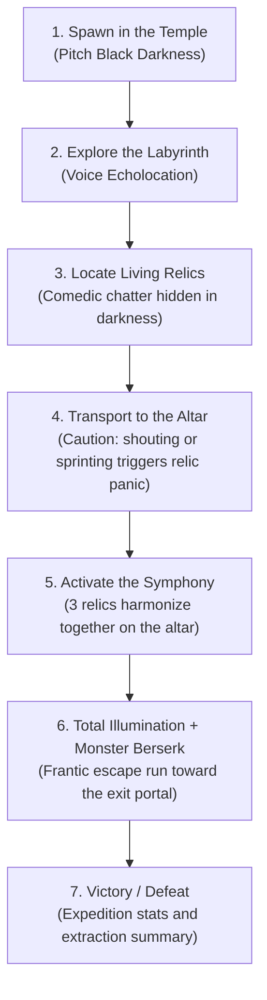
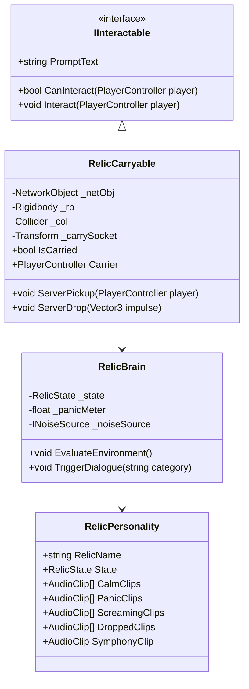

# Echo Protocol — Architecture: "Living Relics" & Game Loop

This document defines the technical architecture, game loop design, and 6-branch engineering plan to transform the current technical prototype into a complete, comedic, and demonstrable multiplayer game before November 1st.

---

## 1. The Game Loop: "The Screaming Relics"



### Core Design Rules
1. **Voice is not just a flashlight; it is an interaction tool:** If the player screams into the microphone, the relic they are carrying panics and screams right back at them.
2. **The relic is a walking hazard:** When chattering, complaining, or panicking, the relic reports noise directly to `NoiseRegistry`, alerting and attracting the blind monster.
3. **The Symphonic Climax:** Placing all 3 relics on the central altar triggers an absurd choral symphony that permanently floods the cavern with light, unlocks the exit portal, and unleashes the monster into an unrelenting berserk frenzy.

---

## 2. Living Relic Technical Architecture



### Relic Components:
1. **`RelicCarryable.cs` (NetworkBehaviour & `IInteractable`):**
   - Handles parenting to the player's carry socket upon pressing `E`.
   - While carried: `Rigidbody.isKinematic = true` and colliders are temporarily disabled.
   - If the carrier is hit into ragdoll (`PlayerRagdoll.OnRagdollStarted`), the relic automatically unparents and launches with outward physics momentum.
2. **`RelicBrain.cs` (NetworkBehaviour):**
   - Emotional state machine:
     - `IdleWaiting`: Resting alone on a pedestal in the dark. Murmurs occasional self-pity lines to help players track it by sound.
     - `CarriedCalm`: Player is sneaking or standing still.
     - `CarriedAnxious`: Player is sprinting (`Shift`) or jumping.
     - `FullPanic`: Carrier screams into mic (`Level01 > 0.7`) or the monster is within 6 metres.
     - `DroppedRagdoll`: Tumbling on the floor after a crash, hurling bitter complaints.
     - `SymphonyChoir`: Anchored to the altar harmonizing with the other relics.
3. **`RelicNoiseEmitter.cs` (`INoiseSource`):**
   - Whenever the relic talks, whines, or screams, it feeds its noise level into `NoiseRegistry`. The blind monster's `HearingSensor` can hear the relic and hunt the carrier.
4. **`RelicVisuals.cs`:**
   - Glowing eye/light materials reacting to emotion: **Soft Blue** (calm), **Pulsing Yellow** (anxious), **Strobing Red** (screaming crisis).

---

## 3. The 3 Personalities & Voice Lines

Designed for emergent co-op comedy and viral streamer moments:

| Reliquia | Name & Archetype | Personality | Sample Voice Lines / Floating Subtitles |
|---|---|---|---|
| **#1** | **"Kevin"** *(The Paranoiac Coward)* | Obsessed with silence, terrified of being eaten | • *Quiet:* "Tell me you're not breathing that loudly on purpose..."<br>• *Sprinting:* "Don't run! Your knees crack like dry firewood!"<br>• *Mic Scream:* "WHY ARE WE SCREAMING?! HE'S GONNA EAT US, YOU IDIOT!"<br>• *On the Floor:* "I chipped a corner! Pick me up before I get stepped on!" |
| **#2** | **"Lord Bob"** *(The Grumpy Aristocrat)* | Arrogant, haughty, disgusted by physical touch | • *Quiet:* "Walk with some decorum, peasant."<br>• *Sprinting:* "Unhand me, beast! Your vulgar trotting gives me motion sickness!"<br>• *Mic Scream:* "Shut up, you acoustic illiterate! You are ruining my peace!"<br>• *On the Floor:* "The floor is filthy! I will have you demoted once we escape!" |
| **#3** | **"Pip"** *(The High-Pitched Hysteric)* | Hyperactive, high-pitched whistle shriek | • *Quiet:* "Hehe... it's dark... very dark... too dark..."<br>• *Sprinting:* "Weeeee! Wait, no, stop, I don't like it, aaaaaah!"<br>• *Mic Scream:* "AAAAAAAAAAAAAAAAAAAH!" *(piercing teapot shriek)*<br>• *On the Floor:* "Help! I am spherical and I can't stop rolling toward the teeth!" |

---

## 4. The Altar & Extraction Climax (`Altar & Escape`)

1. **The Central Altar:**
   - Features 3 receptacles (`AltarSocket`). Pressing `E` while carrying a relic deposits it into the active socket.
   - Each slotted relic begins vibrating and emitting a soft golden pulse.
2. **Activating the Symphony (3/3):**
   - When all 3 relics are placed, they turn toward each other and sing an absurd, cacophonous alien choral harmony.
   - **Visuals:** Calls `EchoShaderPublisher` to emit a continuous, infinite-radius global echo sphere (the entire cavern remains permanently illuminated).
   - **Monster AI:** The monster lets out an enraged shriek and enters permanent `EnemyState.Hunt` with increased speed (7 m/s), bypassing wander/investigate cooldowns.
   - **Escape Portal:** Unlocks the exit gateway with a 45-second countdown before cave collapse.

---

## 5. Engineering Plan (6 Substantial PRs to a Playable Demo)

A structured, trunk-based roadmap to deliver a polished vertical slice before November 1st:

```
[ main ]
   │
   ├── PR 9: feat/interaction-and-carrying ──────────────┐
   │         (Generic IInteractable, network sockets,    │
   │          carrying physics, drop on ragdoll)          │
   │                                                      ▼
   ├── PR 10: feat/living-relic-personality ─────────────┐
   │          (Panic state machine, mic panic reaction,   │
   │           audio/subtitles, monster noise source)     │
   │                                                      ▼
   ├── PR 11: feat/altar-symphony-extraction ────────────┐
   │          (Altar 3/3 sockets, choral symphony,       │
   │           global lighting, portal, Win/Loss flow)    │
   │                                                      ▼
   ├── PR 12: feat/modular-dungeon-level ────────────────┐
   │          (Claustrophobic catacomb level, pillars,    │
   │           blind corners, baked NavMesh)              │
   │                                                      ▼
   ├── PR 13: feat/audio-ambience-retro-vfx ─────────────┐
   │          (Monster roars/breathing, footsteps echo,   │
   │           URP retro/dither aesthetic)                │
   │                                                      ▼
   └── PR 14: feat/ui-menu-and-release-build ────────────▶ [ v1.0 DELIVERABLE DEMO ]
              (UGUI main menu, mic calibration,
               verified Steam .exe build + 90s gameplay trailer)
```

### Detailed Breakdown per Branch:

#### Branch 1 (PR 9): `feat/interaction-and-carrying`
- `IInteractable` interface and `PlayerInteraction` camera raycaster with HUD prompt ("Press [E] to Pick Up / Drop").
- `RelicCarryable`: Socket parenting in first-person and third-person avatars, synchronized via `NetworkTransform`.
- Automatic drop decoupling on ragdoll impact (`PlayerRagdoll.OnRagdollStarted`) applying physical launch velocity.

#### Branch 2 (PR 10): `feat/living-relic-personality`
- `RelicBrain`: Panic state machine observing carrier microphone loudness (`MicrophoneLoudness`).
- Positional 3D audio playback and floating comic-styled speech bubbles.
- `INoiseSource` integration: Relic shrieks and chattering register into `NoiseRegistry`, alerting the monster.

#### Branch 3 (PR 11): `feat/altar-symphony-extraction`
- Ancestral Altar prefab with 3 networked sockets.
- "The Symphony" event: 3-part choral playback, permanent global echolocation reveal, and monster berserk trigger.
- Extraction trigger detecting players reaching the exit portal with Win/Loss screen logic.

#### Branch 4 (PR 12): `feat/modular-dungeon-level`
- Level design: Replaces flat sandbox arena with a claustrophobic catacomb maze featuring columns, narrow hallways, blind corners, and relic shrines.
- Clean NavMesh bake fully tested with `EnemyBrain`.

#### Branch 5 (PR 13): `feat/audio-ambience-retro-vfx`
- Monster SFX: Idling raspy breath and blood-curdling roar upon entering `Hunt`.
- Player footsteps: Emits micro-echo sound pulses (sneaking = silent, sprinting = noisy).
- Retro PS1/dither post-processing volume for an analog horror aesthetic.

#### Branch 6 (PR 14): `feat/ui-menu-and-release-build`
- Polished UGUI Main Menu (Host Steam/Local, Join Game, Microphone Test & Calibration slider).
- End-game screen (Escaped Relics count / Sacrificed players summary).
- Standalone `.exe` release build tested between two Steam accounts, plus 90-second portfolio trailer recording.
