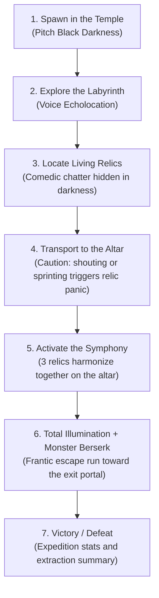
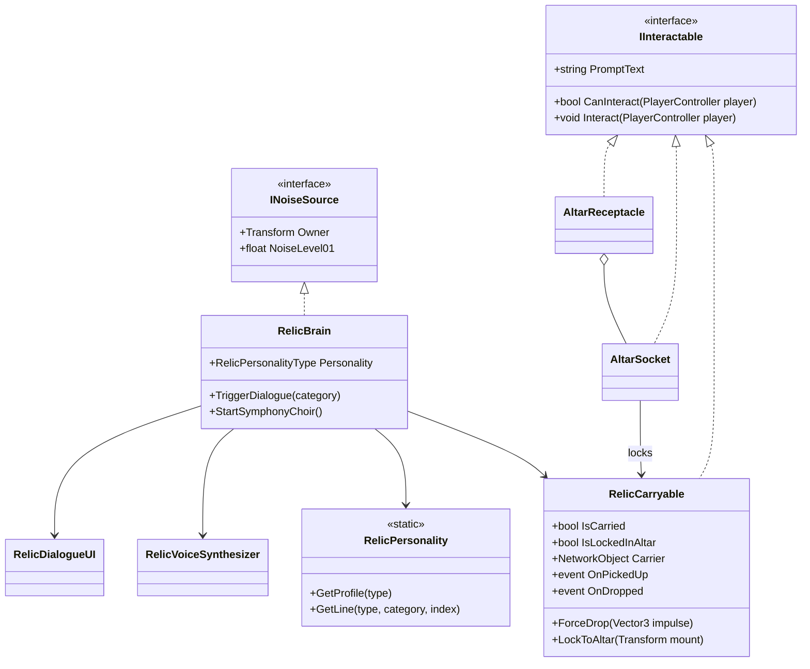

# Echo Protocol — Architecture: "Living Relics" & Game Loop

This document defines the technical architecture, game loop design, and 6-branch engineering plan to transform the technical prototype into a complete, comedic, and demonstrable multiplayer game before November 1st. Each section states what is **implemented** and what is still **planned**.

---

## 1. The Game Loop: "The Screaming Relics"



### Core Design Rules
1. **Voice is not just a flashlight; it is an interaction tool:** If the player screams into the microphone, the relic they are carrying reacts and roasts them.
2. **The relic is a walking hazard:** When chattering, complaining, or flying through the air, the relic reports noise directly to `NoiseRegistry`, alerting and attracting the blind monster.
3. **The Symphonic Climax:** Placing all 3 relics on the central altar triggers an absurd choral symphony that permanently floods the cavern with light, unlocks the exit portal, and unleashes the monster into an unrelenting berserk frenzy.

---

## 2. Living Relic Technical Architecture (implemented)



### Relic Components
1. **`RelicCarryable.cs` (`NetworkBehaviour`, `IInteractable`):**
   - `E` picks the relic up (server validates distance), `E`/`G` drops it. The carrier is a `SyncVar<NetworkObject>`; while carried the Rigidbody is kinematic, the collider is off and the relic is glued to the carrier's `CarrySocket`.
   - If the carrier is knocked into ragdoll (`PlayerRagdoll.OnRagdollStarted`), `PlayerInteraction` calls `ForceDrop` and the relic is launched with outward physics momentum.
   - `LockToAltar` permanently parents the relic to an altar socket.
2. **`RelicBrain.cs` (`NetworkBehaviour`, `INoiseSource`):**
   - There is no explicit state enum: behaviour is driven by timers and thresholds that raise *dialogue categories* (`RelicDialogueCategory`), and by flight detection.

   | Category | Trigger |
   |---|---|
   | `IdleSleep` | Left alone on the ground (periodic murmur, helps players locate it by sound). |
   | `Pickup` / `NormalDrop` | Picked up / dropped gently. |
   | `CarryChatter` | Random chatter every ~16 s while carried. |
   | `Sprinting` | Carrier sprints above 4 m/s for 2.2 s. |
   | `MicReaction` | Carrier voice `Level01` ≥ 0.38 for 0.7 s (also emits noise 0.6). |
   | `MonsterNear` | A non-idle monster within 14 m (15 s cooldown). |
   | `FlyingScream` / `LandedImpact` | Speed ≥ 11.5 m/s after a throw or ragdoll launch; impact on landing. |
   | `AltarPlaced` | Docked into an altar socket. |

   - **Noise reported to `NoiseRegistry`:** talking 0.08, mic reaction 0.60, impact 0.70, flying scream 0.95, symphony choir 0.60 (continuous). The blind monster's `HearingSensor` hears all of it.
   - On the server the brain picks the line and sends it to every peer (`ObserversRpc`).
3. **`RelicPersonality.cs`:** static repository of profiles (name, title, colors, base pitch) and comedy lines per archetype and category.
4. **`RelicVoiceSynthesizer.cs`:** procedural audio with zero external assets: speech blips, a looping Doppler scream while airborne, impact bonks and the altar choir.
5. **`RelicDialogueUI.cs`:** screen-space dialogue card with typewriter text plus a floating world-space bubble above the relic.

*Planned, not implemented:* emotion-colored glowing eyes (`RelicVisuals`, soft blue / pulsing yellow / strobing red).

Debug keys: `T` cycles the personality archetype, `Y` forces a random roast.

---

## 3. The Personalities & Voice

Four archetypes exist today (`RelicPersonalityType`); the sandbox spawns the first three, and the fourth is available for the altar/level work:

| Archetype | Name & Title | Personality | Voice |
|---|---|---|---|
| `SarcasticCritic` | **Obsidian Bob** | Cynical gamer meta-commentary: Steam refunds, posture, cardio roasts. | Mid FM-synth buzz. |
| `AnxiousCoward` | **Nervous Nelly** | Neurotic horror-trope coward who begs the player to whisper. | High, jittery falsetto; siren-like scream. |
| `DumbGloop` | **Gloop the Box** | Goofy babbler that celebrates being an aerodynamic cube. | Bouncy boing/bloop sweeps; kazoo scream. |
| `GrumpyElder` | **Lord Malakor** | Pompous celestial sovereign offended by mortal hands; threatens to curse your Wi-Fi. | Low saw/organ hum; booming roar. |

Each one also hums its own part of the symphony: Bob a C4/E4 drone, Nelly an A4 soprano with vibrato, Gloop an E3 pulsing chant, Malakor a deep A2 drone.

Examples of their post-match lines (from `GameExtractionManager`):
- *Obsidian Bob:* "Don't get cocky. My specular highlight is permanently scratched. 3 stars out of 5."
- *Nervous Nelly:* "WAIT, WE ACTUALLY LIVED?! I had already uninstalled myself in protest!"
- *Lord Malakor:* "A passable retreat, serf. You may now polish my royal casing with micro-fiber silk."

---

## 4. The Altar & Extraction Climax (`Altar & Escape`)

1. **The Central Altar:**
   - `AltarReceptacle` owns 3 `AltarSocket`s. Pressing `E` while carrying a relic docks it into the **closest empty** socket; the relic locks in place and says an `AltarPlaced` line.
   - Socket lights turn from cyan (dormant) to golden (filled); the HUD shows `[filled/3]`.
2. **Activating the Symphony (3/3):**
   - Every docked relic starts its choir loop (`RelicBrain.StartSymphonyChoir`) and keeps emitting noise.
   - **Visuals:** `EchoShaderPublisher.SetFullIllumination(true)` floods the cavern with permanent golden light.
   - **Monster AI:** `EnemyBrain.EnrageAll(7)` puts the monster in a permanent hunt at 7 m/s that tracks the nearest player even in silence.
   - **Escape Portal:** `GameExtractionManager.StartExtraction` unlocks the portal and starts a 45-second countdown.
3. **Resolution:** a player reaching the active portal wins (Victory, rank S+ with a random relic quote); the timer reaching zero loses (Defeat). `R` restarts the match and resets full illumination.

> Current limitation: the altar/extraction loop is local; replicating it is part of the release-build pass. See [Networking limitations](NETWORKING.md#5-current-limitations).

---

## 5. Engineering Plan (6 Substantial PRs to a Playable Demo)

A structured, trunk-based roadmap to deliver a polished vertical slice before November 1st. Status as of October 2026:

| PR | Branch | Status |
|---|---|---|
| 9 | `feat/interaction-and-carrying` | ✅ Merged |
| 10 | `feat/living-relic-personality` | ✅ Merged |
| 11 | `feat/altar-symphony-extraction` | ✅ Merged |
| 12 | `feat/modular-dungeon-level` | ⏳ Pending (the sandbox is still the flat 120×120 m arena) |
| 13 | `feat/audio-ambience-retro-vfx` | ⏳ Pending (`feat/ps1-like-textures` holds an early PS1 shader attempt with a URP Render Graph fix outstanding) |
| 14 | `feat/ui-menu-and-release-build` | ⏳ Pending |

```
[ main ]
   │
   ├── PR 9: feat/interaction-and-carrying ──────────────┐
   │         (Generic IInteractable, network sockets,    │
   │          carrying physics, drop on ragdoll)          │
   │                                                      ▼
   ├── PR 10: feat/living-relic-personality ─────────────┐
   │          (Panic state machine, mic panic reaction,   │
   │           audio/subtitles, monster noise source)     │
   │                                                      ▼
   ├── PR 11: feat/altar-symphony-extraction ────────────┐
   │          (Altar 3/3 sockets, choral symphony,       │
   │           global lighting, portal, Win/Loss flow)    │
   │                                                      ▼
   ├── PR 12: feat/modular-dungeon-level ────────────────┐
   │          (Claustrophobic catacomb level, pillars,    │
   │           blind corners, baked NavMesh)              │
   │                                                      ▼
   ├── PR 13: feat/audio-ambience-retro-vfx ─────────────┐
   │          (Monster roars/breathing, footsteps echo,   │
   │           URP retro/dither aesthetic)                │
   │                                                      ▼
   └── PR 14: feat/ui-menu-and-release-build ────────────▶ [ v1.0 DELIVERABLE DEMO ]
              (UGUI main menu, mic calibration,
               verified Steam .exe build + 90s gameplay trailer)
```

### Detailed Breakdown per Branch:

#### Branch 1 (PR 9): `feat/interaction-and-carrying`
- `IInteractable` interface and `PlayerInteraction` camera raycaster with HUD prompt ("Press [E] to Pick Up / Drop").
- `RelicCarryable`: Socket parenting in first-person and third-person avatars, synchronized via `NetworkTransform`.
- Automatic drop decoupling on ragdoll impact (`PlayerRagdoll.OnRagdollStarted`) applying physical launch velocity.

#### Branch 2 (PR 10): `feat/living-relic-personality`
- `RelicBrain`: reaction system observing carrier sprint, microphone loudness and monster proximity.
- Procedural 3D audio playback and floating comic-styled speech bubbles.
- `INoiseSource` integration: relic shrieks and chattering register into `NoiseRegistry`, alerting the monster.

#### Branch 3 (PR 11): `feat/altar-symphony-extraction`
- Altar with 3 sockets (local objects; networking pending).
- "The Symphony" event: 3-part choral playback, permanent global illumination, and monster berserk trigger.
- Extraction portal with Win/Loss screen logic.

#### Branch 4 (PR 12): `feat/modular-dungeon-level`
- Level design: Replaces flat sandbox arena with a claustrophobic catacomb maze featuring columns, narrow hallways, blind corners, and relic shrines.
- Clean NavMesh bake fully tested with `EnemyBrain`.

#### Branch 5 (PR 13): `feat/audio-ambience-retro-vfx`
- Monster SFX: Idling raspy breath and blood-curdling roar upon entering `Hunt`.
- Player footsteps: Emits micro-echo sound pulses (sneaking = silent, sprinting = noisy).
- Retro PS1/dither post-processing volume for an analog horror aesthetic.

#### Branch 6 (PR 14): `feat/ui-menu-and-release-build`
- Polished UGUI Main Menu (Host Steam/Local, Join Game, Microphone Test & Calibration slider).
- End-game screen (Escaped Relics count / Sacrificed players summary).
- Standalone `.exe` release build tested between two Steam accounts, plus 90-second portfolio trailer recording.
