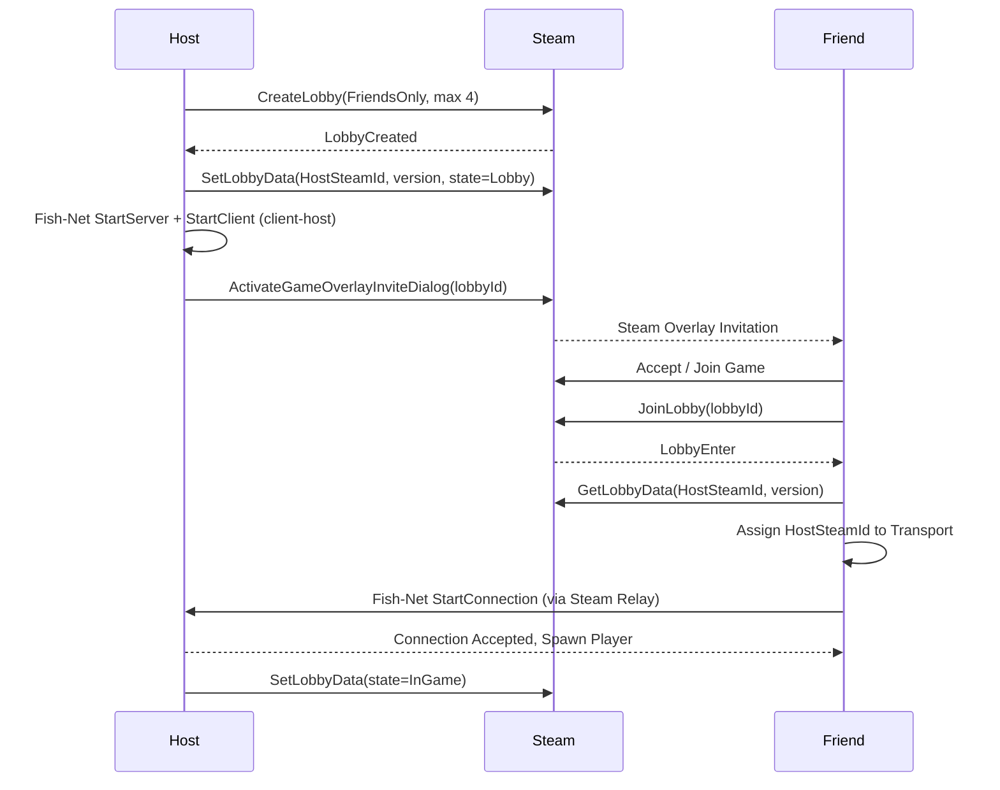

# Echo Protocol: Networking Architecture (P2P + Steam)

> Status: **Accepted & Implemented** (Milestone v0.4.0).

---

## 1. Branch Strategy

### Trunk-based Development with Incremental PRs

| Approach | Verdict |
|---|---|
| Single giant `feat/networking` branch | ❌ Weeks without merging. Causes severe merge conflicts with scene files and shaders. Generates impossible-to-review 5000+ line diffs. |
| Integration `epic/networking` branch | ⚠️ Fallback plan only if a slice cannot enter `main` without breaking it. |
| **Small, focused PRs to `main`, grouped by Milestone** | ✅ `main` remains constantly playable, clean linear git history, incremental deliverability. |

**GitHub Standards for Professional Portfolio:**
1. **Milestones & Issues:** Milestones grouped by scope (`v0.4.0 Networking`, `v0.5.0 Living Relics`, etc.) with clear Definition of Done checklists.
2. **Branch Protection:** Linear history, pull request required, clean conventional commit messages.
3. **Squash Merges:** Every PR closes its corresponding issue (`Closes #N`) using the repository PR template.
4. **Playable Baseline:** Offline fallback is preserved at all stages. Sandbox remains functional without network dependencies.

---

## 2. Networking Architecture

### Tech Stack (100% Free / MIT)

| Component | Choice | Rationale |
|---|---|---|
| Netcode | **Fish-Net** | Supports Unity 6, excellent client-host performance, clean prediction/reconciliation model. |
| Steam API | **Steamworks.NET** (MIT) | Foundation dependency required by FishySteamworks. |
| Steam Transport | **FishySteamworks** | Fish-Net P2P transport operating over Steam Sockets. |
| Dev Transport | **Tugboat** (UDP) | Built-in Fish-Net transport for rapid localhost iteration. |
| Relay / NAT Punchthrough | **Steam Datagram Relay** | Free with Steam. Bypasses NAT without opening router ports; hides host IP. |
| Local Testing | **Multiplayer Play Mode (MPPM)** | Simulates multiple players concurrently within Unity Editor. |

### Topology: Client-Host (Listen Server)

One player runs as both server and client. No dedicated server hosting costs.

- **Host (Server):** Runs enemy AI, authoritative game rules, relic states, and world state.
- **Clients:** Authoritative over their local movement and microphone audio capture.
- **Host Migration:** Not supported in v1 (matches *Lethal Company* / *Phasmophobia* design; if host disconnects, session resets to menu).

### Control Plane (Steam Lobby) vs Data Plane (Fish-Net)

Steam lobbies serve solely as the discovery and rendezvous layer: who enters, current player count, and host address. Once paired, Fish-Net manages active gameplay transmission.

### Authority Matrix

| Subsystem | Authority | Transport | Implementation |
|---|---|---|---|
| Player Movement | Owning Client | `NetworkTransform` with client authority | `PlayerController`, camera, and input active only on owner. |
| Voice Loudness | Owning Client → Server | `ServerRpc` sending quantized loudness (10 Hz) | Server feeds loudness to `IVoiceLevelSource` for remote players. |
| Noise for AI | Server | Evaluated server-side via `NoiseRegistry` | Remote avatars register loudness into server `NoiseRegistry`. |
| Enemy AI | **Server** | Server-authoritative `NetworkTransform` | `NavMeshAgent` and `HearingSensor` disabled on remote clients. |
| Ragdoll Knockback | Server decides, Owner executes | Reliable `ObserversRpc` | `EnemyCatchReaction` invokes `RpcTriggerRagdoll` on the victim. |
| Echolocation Pulses | Replicated across all peers | Quantized `SyncVar<float>` + `EchoShaderPublisher` | Up to 4 simultaneous spheres rendered in `EchoReveal.shader`. |
| Relic Pick-up / Drop | Server | `SyncVar<NetworkObject>` carrier + `ServerRpc` | `RelicCarryable`: server validates distance (5 m) and ignores relics already locked in the altar. |
| Relic Dialogue | Server → observers | `ObserversRpc` | `RelicBrain` picks the line on the server; clients only display and voice it. |
| Altar Docking | Server | `ServerRequestDock` + replicated filled mask (`SyncVar<int>`) | `AltarReceptacle` checks carrier, socket, distance (6 m) and completion; `AltarRules` holds the rules. |
| Symphony & Match Flow | Server | Replicated state, countdown and end-screen quote (`SyncVar`) | `GameExtractionManager` (win/lose/restart) and `MatchRules`. A client reaching the portal asks the server with `ServerRequestEscape`. |
| Restart | Server | `ServerRequestRestart` → `NetworkBootstrap.ServerRespawnWorld` | Relics and monster are despawned and spawned again; players get a `TargetRpc` to move back to a spawn point. |
| Voice Chat | Proximity Voice Plugin | Separate voice channel | Decided in audio polish phase. |

---

## 3. Implementation Notes

- **Network rig:** all multiplayer wiring lives in one prefab, `Assets/Prefabs/Networking/NetworkRig.prefab` (`NetworkManager`, `TransportManager` + Tugboat, `PlayerSpawner`, Steam lobby support and `NetworkBootstrap`). It is generated by `NetworkRigBuilder` (menu *Echo Protocol → Build → Network Rig Prefab*) and put into scenes by `NetworkRigInstaller`, which the level builders call. The rig was once lost when a scene was regenerated; now EditMode tests fail if the prefab is incomplete or if any scene in the build (except the deliberately offline `Sandbox_Test`) lacks it.
- **Bootstrap:** `NetworkBootstrap` wires the Tugboat transport, spawn points and the spawnable prefab list (Player, Enemy, Relic), points the player spawner at the level's `SpawnPoint`s and spawns the monster and a test relic when the server starts. Its public API (`StartLocalHost`, `JoinLocalClient`, `Disconnect`, `HostSteamLobby`) drives the on-screen panel, the tests and, later, the menu.
- **Launch flags:** `-echo-host` starts a local host, `-echo-join [address]` joins one and `-echo-no-steam` keeps the game away from the Steam client (used by the automated tests; it also exercises the play-without-Steam path). Parsed by `LaunchOptions` (unit-tested). The serialized `Auto Start` field on the rig does the same without flags.
- **Players come from the network:** a networked level holds no `Player` or `Enemy` of its own; `PlayerSpawner` creates one player per connection at the level's player spawn points. A scene copy would duplicate it.
- **Steam lobbies:** `SteamLobbyManager` hosts friends-only lobbies (max 4). A joining client reads `HostAddress` from the lobby data and connects through FishySteamworks. The lobby owner never connects to itself, even if `LobbyEnter_t` arrives before FishNet reports the server as started.
- **Steam shutdown:** Steamworks callbacks are disposed and the lobby is left in `OnDisable`, because touching `SteamManager.Initialized` from `OnDestroy` can re-create the manager while quitting.
- **SyncVar callbacks on the host:** a host receives `OnChange` twice (`asServer` true and false). Handlers that raise gameplay events (e.g. `RelicCarryable`) process only the server call on a host.
- **Microphone:** capture is reference counted (see [Architecture](ARCHITECTURE.md)); remote avatars never open or close the local device.
- **Altar and match flow:** `AltarReceptacle` and `GameExtractionManager` are scene `NetworkObject`s. The server decides every docking, the symphony, the win/lose result and the restart; the clients mirror it through `SyncVar`s. FishNet keeps scene NetworkObjects inactive until a host or client starts, so the altar, the exit and the match manager exist in `Dungeon_Main` only during a session. Without a network (the sandbox) the same code runs locally: each state keeps a local copy and only the server also writes the `SyncVar`s. Pure rules live in `AltarRules` and `MatchRules`, which the EditMode tests cover.
- **Relics:** one living relic spawns per shrine (the level's relic spawn points), each with its shrine's personality. The personality replicates, so every peer speaks and sings with the same voice. A relic docked in the altar locks on every peer (`SyncVar<bool>`), and its position replicates through `NetworkTransform`.
- **Restart:** the server calls `NetworkBootstrap.ServerRespawnWorld()`. A scene reload would end the FishNet session, so it is used only offline.

## 4. Offline Fallback

If a scene has no `NetworkManager` (today only `Sandbox_Test`), `OfflineSandboxGuard` flags scene `NetworkObject`s as non-networked and binds every `NetworkBehaviour`, so the sandbox runs as a plain single-player scene (`IsSpawned` / `IsOwner` are `false`). Gameplay code therefore branches on `IsSpawned` and keeps a local path. The guard runs for the first scene and on every later `sceneLoaded`, and clears its offline flag when a networked scene loads.

`Dungeon_Main` is networked: press Play, then use the panel (*Host Local*, or *Join Local Client* from a second instance). For instant play set `Auto Start` to *Host* on the rig prefab, or launch with `-echo-host`.

## 5. Current Limitations

These are known gaps, tracked for the networking pass of the release branch:

- **Steam transport is not wired:** the rig only contains Tugboat. `HostSteamLobby` and the lobby join path assume the active transport is FishySteamworks, which is not on the rig, and switching transports at runtime needs each transport initialised and its events wired. Steam multiplayer is unverified until that is done and tested between two Steam accounts. Local hosting and joining over Tugboat are covered by tests.
- **Escape is trusted:** the portal trigger runs on the owner's client, and the server accepts a spawned player's report that they reached the exit while the match is active. There is no position check on the server yet.
- **Dock range is the only altar check:** the server checks that the player carries the relic, the socket is free, and the player is within 6 m. It does not check line of sight or the interaction cooldown.
- **Remote carrier sensing:** `RelicBrain` reads the carrier's sprint state from `PlayerController`, which is only simulated on the owner. For a remote carrier the server sees no sprint, so only the mic and monster reactions work.
- **Remote ragdoll state:** the server cannot tell whether a remote player is ragdolling or immune (see [Enemy AI](ENEMY_AI.md#known-limitations)).
- **Debug keys** (`H`, `J`, `T`, `Y`, `V`, debug ragdoll) exist only in the Editor and Development builds and act locally.
