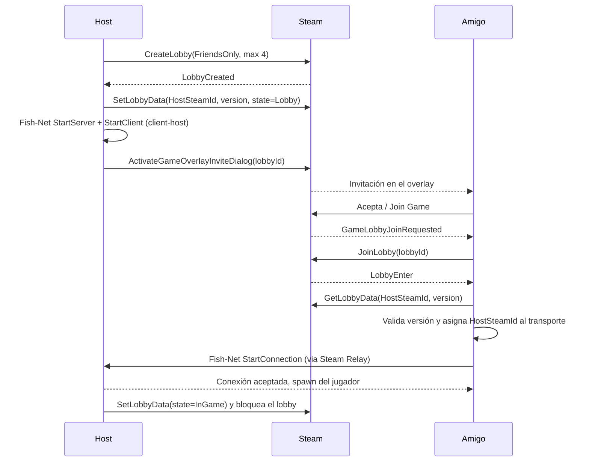
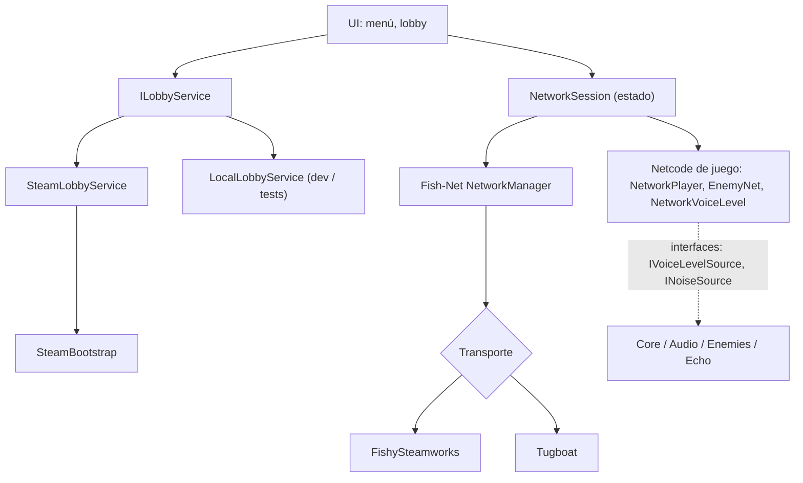

# Echo Protocol: Diseño de Networking (P2P + Steam)

> Estado: **propuesta**. No se ha modificado nada en el repo. Una vez aprobada, el primer PR la convierte en `docs/NETWORKING.md`.

## Hallazgos del proyecto actual

- Ya existe un modelo de ramas en [CONTRIBUTING.md](file:///c:/Users/danie/EchoGame/CONTRIBUTING.md): **trunk-based**, ramas `feat/`, `fix/`, `docs/`, `chore/`, squash merge, Conventional Commits. Este diseño lo respeta.
- [ARCHITECTURE.md](file:///c:/Users/danie/EchoGame/docs/ARCHITECTURE.md) ya define la autoridad: *enemigos solo en el servidor, cada cliente es dueño de su jugador*, y que el código de red vive en `Scripts/Networking/`.
- Las abstracciones que facilitan la red ya existen: `IVoiceLevelSource`, `INoiseSource` y `NoiseRegistry`. El audio remoto entra al juego sin tocar la IA.
- Ningún paquete de red está instalado (`Packages/manifest.json`), así que partimos de cero.
- `feat/ps1-like-textures` está limpia y subida a origin, pero **aún no está en `main`** y tiene el bug del Render Graph pendiente. Ver "Decisiones abiertas".

---

## 1. Estrategia de ramas

### Recomendación: seguir trunk-based, **sin** una mega-rama `feat/networking`

| Opción | Veredicto |
|---|---|
| Una sola rama larga `feat/networking` | ❌ Semanas sin integrar. Choca con `EchoSandboxBuilder.cs`, `EchoReveal.shader` y las escenas, que cambian en otras ramas. Un solo PR de 5000 líneas que nadie puede revisar. |
| Rama de integración `epic/networking` con sub-ramas | ⚠️ Es el plan B. Solo se usa si un slice no puede entrar a `main` sin romperlo. |
| **Muchos PRs pequeños a `main`, agrupados por Milestone** | ✅ `main` siempre jugable, historial legible, entrega incremental. Es lo que hacen los equipos pequeños y lo que un reclutador quiere ver. |

**Cómo se ve en GitHub (esto es lo que demuestra trabajo en equipo):**
1. **Milestone** `v0.4.0 Networking` con un **Issue por rama** (checklist de "definición de terminado").
2. Un **Project board** (Todo / In progress / In review / Done), aunque trabajes solo.
3. **Branch protection en `main`**: PR obligatorio, historial lineal, sin push directo.
4. Cada PR enlaza su issue (`Closes #N`), usa la plantilla y se hace **squash merge**.
5. Reglas para que `main` siga jugable durante todo el desarrollo:
   - El modo por defecto sigue siendo **Offline**. El sandbox actual funciona sin Steam ni red.
   - Paquetes de terceros van en su **propio PR** (`chore/`), porque su diff es enorme.
   - Los cambios de escena van en PR aparte cuando sea posible.
   - El código de red vive en su propio assembly (`asmdef`). El código de juego no lo referencia.

### Secuencia de ramas (cada una es un PR a `main`)

| # | Rama | Qué entrega | Terminado cuando |
|---|---|---|---|
| 1 | `docs/networking-architecture` | Este documento como `docs/NETWORKING.md` + ADR de decisiones + README actualizado | Revisado y mergeado |
| 2 | `chore/net-packages` | Fish-Net, Steamworks.NET, FishySteamworks, Multiplayer Play Mode, asmdefs, `steam_appid.txt` (480) | El proyecto compila y el sandbox offline sigue igual |
| 3 | `feat/net-bootstrap` | `NetworkManager` + transporte local (Tugboat) + `NetworkSession` (Offline/Hosting/Joining/Connected) | Host y Join por localhost con Multiplayer Play Mode |
| 4 | `feat/net-player-sync` | Prefab de jugador con `NetworkObject`; los remotos desactivan cámara, input y micrófono | 2 jugadores se ven moverse |
| 5 | `feat/net-voice-level` | `NetworkVoiceLevel` (1 byte a 10 Hz) como `IVoiceLevelSource` remoto; ruido remoto registrado en `NoiseRegistry` del servidor | El enemigo reacciona a la voz de un cliente |
| 6 | `feat/net-enemy-authority` | IA solo en servidor, elige objetivo entre N jugadores, posición replicada | El enemigo persigue a cualquiera de los 4 |
| 7 | `feat/net-echo-multi-origin` | Shader con arrays `_EchoOrigins[4]` / `_EchoRadii[4]` | Cada jugador ilumina su esfera para todos |
| 8 | `feat/net-ragdoll-sync` | Estado de ragdoll replicado (solo la cadera, las extremidades son cosméticas) | Ver caer al compañero |
| 9 | `feat/steam-init` | `SteamBootstrap` (init + `RunCallbacks`) y transporte FishySteamworks intercambiable | Conectar dos máquinas por Steam con AppID 480 |
| 10 | `feat/steam-lobby` | `ILobbyService` + lobby Steam: crear, invitar por overlay, unirse desde amigos, bloqueo al iniciar | Amigo acepta invitación y entra |
| 11 | `feat/net-session-resilience` | Host se va, cliente cae, versiones distintas, timeouts | Ningún escenario deja el juego colgado |

**Por qué Steam va casi al final (9-10):** Steam solo es la tubería de transporte y descubrimiento. Primero se valida toda la lógica de red en localhost, donde se prueba en segundos con Multiplayer Play Mode. Si se empieza por Steam, cada prueba exige dos cuentas y dos máquinas, y no se sabría si un fallo viene de Steam o del netcode.

Nombres de commit y PR siguen Conventional Commits con scope `net` o `steam`: `feat(net): replicate player transform`.

---

## 2. Arquitectura de red

### Stack (todo gratuito)

| Pieza | Elección | Motivo |
|---|---|---|
| Netcode | **Fish-Net** | Ya elegido en README. Soporta Unity 6, client-host y buen rendimiento. |
| API de Steam | **Steamworks.NET** (MIT) | Es la dependencia que exige FishySteamworks. |
| Transporte Steam | **FishySteamworks** | Transporte de Fish-Net sobre Steam. |
| Transporte dev | **Tugboat** (UDP, incluido en Fish-Net) | Pruebas locales sin Steam. |
| Relay / NAT | **Steam Datagram Relay** | Gratis con Steam. Resuelve NAT y oculta la IP del host. Sin servidores propios. |
| Pruebas locales | **Multiplayer Play Mode** (paquete de Unity) | Varios jugadores virtuales en un editor. |

> [!IMPORTANT]
> Tu requisito es usar **Steam Networking Sockets**. Antes de cerrar la elección, verifica en la versión de FishySteamworks que instalemos que usa `ISteamNetworkingSockets` y no la API P2P antigua (`ISteamNetworking`). Se confirma en el PR 2. Si fuera la antigua, el plan B es un transporte propio de unas 300 líneas sobre Steamworks.NET.

### Topología: client-host (listen server)

Un jugador es a la vez servidor y cliente. No hay servidor dedicado, no hay costo.

- El **host** ejecuta la IA del enemigo y es autoridad de todo lo compartido.
- Los **clientes** son dueños de su propio movimiento y su micrófono.
- **No hay migración de host.** Si el host se va, la sesión termina y todos vuelven al menú. Es lo que hacen Lethal Company y Phasmophobia, y evita meses de trabajo.
- Contrapartida aceptada: el host tiene latencia cero y podría hacer trampa. Es irrelevante en un cooperativo entre amigos.

### Lobby = plano de control, Fish-Net = plano de datos

El lobby de Steam solo sirve para **encontrarse**: quién entra, cuántos hay y a quién conectarse. Cuando termina el emparejamiento, el juego usa Fish-Net y el lobby queda como presencia.



Detalles que importan:
- Si el juego **no estaba abierto** al aceptar la invitación, Steam lo lanza con `+connect_lobby <id>`. Hay que leer esa línea de comandos al arrancar.
- **Máximo 4**, aplicado en dos sitios: `maxMembers = 4` en el lobby y rechazo de conexiones en el servidor de Fish-Net.
- Al iniciar la partida el lobby pasa a no unible (sin join-in-progress en v1).
- El lobby guarda `version`. Si no coincide con la del cliente, se rechaza antes de conectar.
- Visibilidad `FriendsOnly`: aparece en la lista de amigos de Steam. Cumple tu requisito sin servidor de matchmaking.

### Capas y dependencias



Regla de dependencias: **Core no conoce a Networking**; Networking sí conoce a Core. Se aplica con asmdefs.

```
Assets/Scripts/Networking/
  Core/        NetworkSession, NetworkConfig, ILobbyService
  Steam/       SteamBootstrap, SteamLobbyService, SteamInviteHandler
  Local/       LocalLobbyService
  Player/      NetworkPlayer, NetworkVoiceLevel
  Enemies/     EnemyNetworkAdapter
  EchoProtocol.Networking.asmdef
```

### Autoridad (extiende la tabla de ARCHITECTURE.md)

| Sistema | Autoridad | Cómo viaja | Cambio en código existente |
|---|---|---|---|
| Movimiento del jugador | Dueño | Transform sincronizado con interpolación | `PlayerController`, cámara y input solo en el dueño |
| Nivel de voz | Dueño → todos | 1 byte a ~10 Hz (el audio no pasa por aquí) | Nuevo `IVoiceLevelSource` remoto |
| Ruido para la IA | Servidor | Derivado del nivel de voz recibido | Jugadores remotos se registran en `NoiseRegistry` del servidor |
| Enemigo (IA, NavMesh) | **Servidor** | Posición y estado replicados | `NavMeshAgent` y `EnemyBrain` solo activos en el servidor |
| Captura / ragdoll | Servidor decide, dueño ejecuta | RPC reliable + cadera sincronizada | `EnemyCatchReaction` dispara un RPC |
| Luz de eco | Dueño → todos | Origen y radio por jugador | `EchoVisionController` pasa de 1 origen global a arrays de 4 |
| Voz de chat | Plugin aparte | Fuera de este alcance | Se decide después |

Presupuesto de red: 4 jugadores, tick de 30 Hz, un byte de voz por jugador y un enemigo. Son unos pocos KB/s. No hay riesgo de ancho de banda.

### Estrategia de pruebas
1. **Lógica pura en EditMode** (cuantización del byte de voz, máquina de estados de sesión, validación de versión). No necesita red.
2. **Multiplayer Play Mode + Tugboat** para el netcode del juego (ramas 3 a 8).
3. **Dos cuentas / dos máquinas en AppID 480** para Steam (ramas 9 a 11). Un mismo PC no puede ser dos clientes de Steam. Hay que planificar un amigo o un segundo equipo.

### Steam y presupuesto
- Para desarrollo se usa el **AppID 480 (Spacewar)**, gratis y compartido.
- Steam Datagram Relay y Networking Sockets no cuestan nada.
- El único costo es la cuota de **Steam Direct** para tener tu propio AppID al publicar. Es en la fase final, no ahora.

### Riesgos

| Riesgo | Mitigación |
|---|---|
| FishySteamworks no cubre Unity 6 o usa la API antigua | Verificar en el PR 2; plan B de transporte propio |
| Conflictos con `EchoSandboxBuilder` y el shader de eco | PRs pequeños; decidir primero el orden con la rama PS1 |
| Dificultad para probar Steam con una sola cuenta | Dejar Steam al final; todo lo demás se prueba en local |
| Host abandona la partida | Aceptado en v1; manejado en la rama 11 |

---

## 3. Primeros pasos

```powershell
git switch main
git pull
git switch -c docs/networking-architecture
```

1. Crear en GitHub el milestone `v0.4.0 Networking` y los 11 issues de la tabla.
2. Activar la protección de `main`.
3. Rama 1: pasar este documento a `docs/NETWORKING.md`, actualizar el README (Fish-Net + Steamworks.NET + FishySteamworks) y el CHANGELOG.
4. Rama 2: instalar paquetes y confirmar la API de Steam que usa FishySteamworks.

## Decisiones abiertas

1. **¿Qué se hace con `feat/ps1-like-textures`?** Opciones: (a) arreglar el Render Graph antes y mergear, (b) mergear con el feature de PS1 desactivado en el renderer para que `main` siga jugable, (c) dejarla y mergearla después. Conviene decidirlo antes de la rama 7 porque ambas tocan `EchoReveal.shader`.
2. **¿Cada jugador ve los ecos de todos?** El diseño asume que sí (4 esferas de luz visibles para todos).
3. **¿Se permite entrar a una partida en curso?** Se asume que no en v1.
4. **Chat de voz:** se aplaza. Las opciones son Steam Voice (gratis, requiere trabajo propio) o Dissonance (de pago, integra con Fish-Net).
