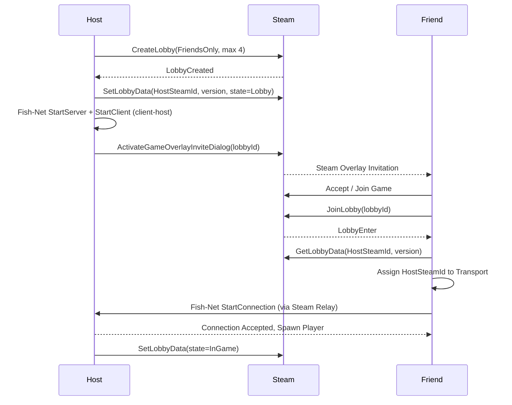

# Networking architecture (P2P and Steam)

Status: implemented. Local hosting and joining over Tugboat work and are covered by tests. The Steam transport is not wired yet (see [current limitations](#5-current-limitations)).

---

## 1. How I handle the work

I build networking the same way as everything else in the project: small, focused pull requests into `main`, not one huge `feat/networking` branch.

| Approach | What I thought |
|---|---|
| One giant `feat/networking` branch | Weeks without merging. It conflicts badly with scene files and shaders, and a 5000-line diff is impossible to review. |
| An integration `epic/networking` branch | Only a fallback, if a slice cannot enter `main` without breaking it. |
| **Small PRs into `main`, grouped by milestone** | `main` stays playable, the history stays linear and I can deliver in steps. This is what I use. |

My rules:
1. Group the work in milestones (`v0.4.0 Networking`, `v0.5.0 Living Relics`, and so on), with a checklist of what "done" means for each.
2. Every PR uses the repository template, closes its issue (`Closes #N`) and is merged with a squash.
3. The offline fallback always works. The sandbox runs without any network.

---

## 2. Architecture

### Tech stack (all free to use)

| Component | Choice | Why |
|---|---|---|
| Netcode | **Fish-Net** | It supports Unity 6, performs well in client-host mode and has a clean prediction and reconciliation model. |
| Steam API | **Steamworks.NET** (MIT) | FishySteamworks depends on it. |
| Steam transport | **FishySteamworks** | A Fish-Net P2P transport that runs over Steam sockets. |
| Development transport | **Tugboat** (UDP) | Built into Fish-Net. It is fast to iterate on over localhost. |
| Relay and NAT punchthrough | **Steam Datagram Relay** | Free with Steam. It gets through NAT without opening router ports and hides the host's IP. |
| Local testing | **Multiplayer Play Mode** | Simulates several players at once inside the Unity Editor. |

### Topology: client-host (listen server)

One player runs as both the server and a client. There are no dedicated server costs.

- **Host (server):** runs the enemy AI, the game rules, the relic states and the state of the world.
- **Clients:** are authoritative over their own movement and microphone capture.
- **Host migration:** not supported in v1. Like *Lethal Company* and *Phasmophobia*, if the host disconnects the session ends.

### Control plane (Steam lobby) and data plane (Fish-Net)

A Steam lobby is only used for discovery and for bringing players together: who is in, how many players there are and the host's address. Once the players are paired, Fish-Net carries the gameplay traffic.

### Who has authority over what

| Subsystem | Authority | Transport | Implementation |
|---|---|---|---|
| Player movement | Owning client | `NetworkTransform` with client authority | `PlayerController`, the camera and the input are only active on the owner. |
| Voice loudness | Owning client to server | `ServerRpc` with a quantized loudness (10 Hz) | The server feeds the loudness to `IVoiceLevelSource` for remote players. |
| Noise for the AI | Server | Evaluated on the server through `NoiseRegistry` | Remote avatars register their loudness in the server's `NoiseRegistry`. |
| Enemy AI | **Server** | Server-authoritative `NetworkTransform` | `NavMeshAgent` and `HearingSensor` are disabled on remote clients. |
| Ragdoll knockback | The server decides, the owner executes | Reliable `ObserversRpc` | `EnemyCatchReaction` calls `RpcTriggerRagdoll` on the victim. |
| Echo pulses | Replicated to all peers | Quantized `SyncVar<float>` and `EchoShaderPublisher` | Up to 4 spheres at once in `EchoReveal.shader`. |
| Relic pick-up and drop | Server | `SyncVar<NetworkObject>` for the carrier, plus a `ServerRpc` | `RelicCarryable`: the server checks the distance (5 m) and ignores relics that are already locked in the altar. |
| Relic dialogue | Server to observers | `ObserversRpc` | `RelicBrain` picks the line on the server. Clients only show it and play the voice. |
| Altar docking | Server | `ServerRequestDock` and a replicated mask of filled sockets (`SyncVar<int>`) | `AltarReceptacle` checks the carrier, the socket, the distance (6 m) and completion. `AltarRules` holds the rules. |
| Symphony and match flow | Server | Replicated state, countdown and end-screen quote (`SyncVar`) | `GameExtractionManager` (win, lose, restart) and `MatchRules`. A client that reaches the portal tells the server with `ServerRequestEscape`. |
| Restart | Server | `ServerRequestRestart` then `NetworkBootstrap.ServerRespawnWorld` | The relics and the monster are despawned and spawned again, and each player gets a `TargetRpc` to move back to a spawn point. |
| Voice chat | Proximity voice plugin | A separate voice channel | I will decide this in the audio polish phase. |

---

## 3. Implementation notes

- **Network rig:** all the multiplayer setup is one prefab, `Assets/Prefabs/Networking/NetworkRig.prefab` (`NetworkManager`, `TransportManager` with Tugboat, `PlayerSpawner`, Steam lobby support and `NetworkBootstrap`). `NetworkRigBuilder` generates it (menu *Echo Protocol > Build > Network Rig Prefab*) and `NetworkRigInstaller` puts it into scenes, which the level builders call. The rig got lost once when I regenerated a scene. Now EditMode tests fail if the prefab is incomplete or if any scene in the build (except the offline `Sandbox_Test`, on purpose) is missing it.
- **Bootstrap:** `NetworkBootstrap` sets up the Tugboat transport, the spawn points and the list of spawnable prefabs (Player, Enemy, Relic). It points the player spawner at the level's `SpawnPoint`s, and it spawns the monster and a test relic when the server starts. Its public API (`StartLocalHost`, `JoinLocalClient`, `Disconnect`, `HostSteamLobby`) drives the on-screen panel, the tests and, later, the menu.
- **Launch flags:** `-echo-host` starts a local host, `-echo-join [address]` joins one, and `-echo-no-steam` keeps the game away from the Steam client (the automated tests use it, and it also exercises the path for playing without Steam). `LaunchOptions` parses them and has unit tests. The serialized `Auto Start` field on the rig does the same without flags.
- **Players come from the network:** a networked level contains no `Player` or `Enemy` of its own. `PlayerSpawner` creates one player for each connection at the level's player spawn points. A copy in the scene would duplicate it.
- **Steam lobbies:** `SteamLobbyManager` hosts friends-only lobbies (max 4). A client that joins reads `HostAddress` from the lobby data and connects through FishySteamworks. The lobby owner never connects to itself, even if `LobbyEnter_t` arrives before FishNet reports that the server has started.
- **Steam shutdown:** Steamworks callbacks are disposed and the lobby is left in `OnDisable`. Touching `SteamManager.Initialized` from `OnDestroy` can create the manager again while the game is quitting.
- **SyncVar callbacks on the host:** a host gets `OnChange` twice (`asServer` true and false). Handlers that raise gameplay events (for example `RelicCarryable`) only process the server call on a host.
- **Microphone:** capture is reference counted (see [Architecture](ARCHITECTURE.md)), so remote avatars never open or close the local device.
- **Altar and match flow:** `AltarReceptacle` and `GameExtractionManager` are scene `NetworkObject`s. The server decides every docking, the symphony, the win or lose result and the restart, and the clients copy it through `SyncVar`s. FishNet keeps scene NetworkObjects inactive until a host or client starts, so the altar, the exit and the match manager only exist in `Dungeon_Main` during a session. Without a network (the sandbox), the same code runs locally: each state keeps a local copy, and only the server also writes the `SyncVar`s. The pure rules live in `AltarRules` and `MatchRules`, and the EditMode tests cover them.
- **Relics:** one living relic spawns for each shrine (the level's relic spawn points), with the personality of that shrine. The personality is replicated, so every peer speaks and sings with the same voice. A relic docked in the altar locks on every peer (`SyncVar<bool>`), and its position replicates through `NetworkTransform`.
- **Restart:** the server calls `NetworkBootstrap.ServerRespawnWorld()`. A scene reload would end the FishNet session, so I only use it offline.

## 4. Offline fallback

If a scene has no `NetworkManager` (today only `Sandbox_Test`), `OfflineSandboxGuard` marks the scene `NetworkObject`s as non-networked and binds every `NetworkBehaviour`, so the sandbox runs as a normal single-player scene (`IsSpawned` and `IsOwner` are `false`). Gameplay code therefore branches on `IsSpawned` and keeps a local path. The guard runs for the first scene and again on every later `sceneLoaded`, and it clears its offline flag when a networked scene loads.

`Dungeon_Main` is networked. Press Play and use the panel (*Host Local*, or *Join Local Client* from a second instance). To start right away, set `Auto Start` to *Host* on the rig prefab, or launch with `-echo-host`.

## 5. Current limitations

These are known gaps that I plan to fix in the networking pass of the release branch:

- **The Steam transport is not wired.** The rig only contains Tugboat. `HostSteamLobby` and the lobby join path assume that the active transport is FishySteamworks, which is not on the rig, and switching transports at runtime needs each transport to be initialised and its events wired. Steam multiplayer is unverified until that is done and tested between two Steam accounts. Tests cover local hosting and joining over Tugboat.
- **Escaping is trusted.** The portal trigger runs on the owner's client, and the server accepts the report of a spawned player who says they reached the exit while the match is active. The server does not check their position yet.
- **The dock range is the only altar check.** The server checks that the player carries the relic, that the socket is free and that the player is within 6 m. It does not check line of sight or the interaction cooldown.
- **Sensing a remote carrier.** `RelicBrain` reads the carrier's sprint state from `PlayerController`, which only runs on the owner. For a remote carrier the server sees no sprint, so only the microphone and monster reactions work.
- **Remote ragdoll state.** The server cannot tell whether a remote player is ragdolling or immune (see [Enemy AI](ENEMY_AI.md#known-limitations)).
- **Debug keys** (`H`, `J`, `M`, `T`, `Y`, `V` and the debug ragdoll) only exist in the Editor and in Development builds, and they act locally.
