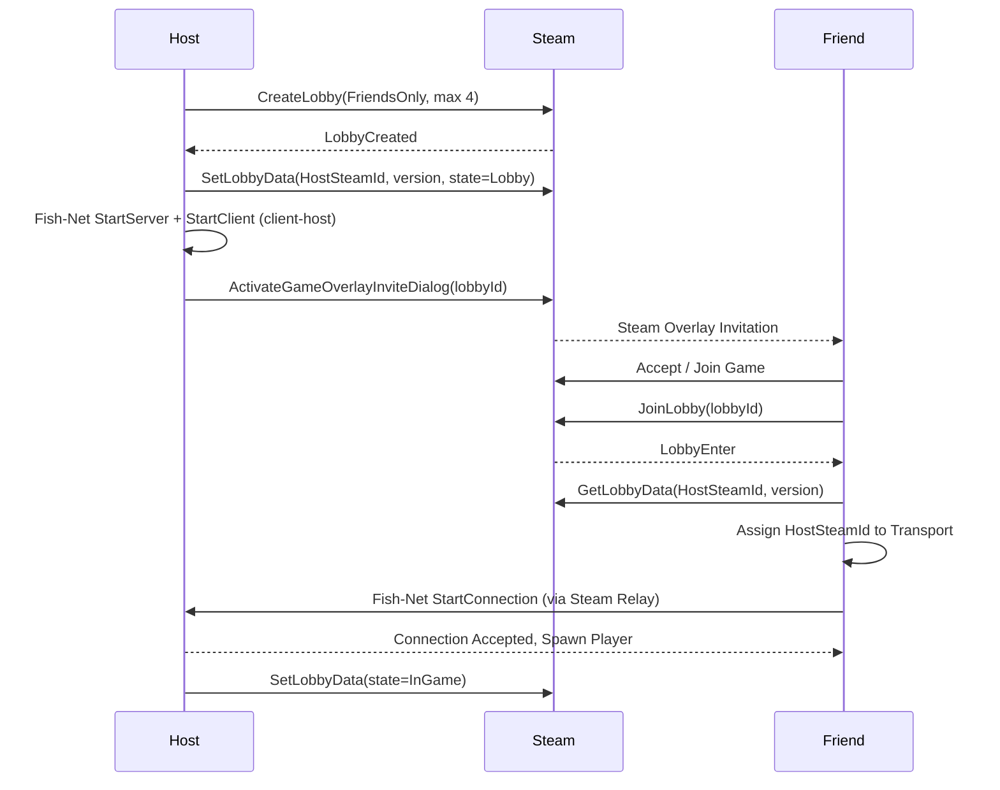

# Echo Protocol: Networking Architecture (P2P + Steam)

> Status: **Accepted & Implemented** (Milestone v0.4.0).

---

## 1. Branch Strategy

### Trunk-based Development with Incremental PRs

| Approach | Verdict |
|---|---|
| Single giant `feat/networking` branch | ❌ Weeks without merging. Causes severe merge conflicts with scene files and shaders. Generates impossible-to-review 5000+ line diffs. |
| Integration `epic/networking` branch | ⚠️ Fallback plan only if a slice cannot enter `main` without breaking it. |
| **Small, focused PRs to `main`, grouped by Milestone** | ✅ `main` remains constantly playable, clean linear git history, incremental deliverability. |

**GitHub Standards for Professional Portfolio:**
1. **Milestones & Issues:** Milestones grouped by scope (`v0.4.0 Networking`, `v0.5.0 Living Relics`, etc.) with clear Definition of Done checklists.
2. **Branch Protection:** Linear history, pull request required, clean conventional commit messages.
3. **Squash Merges:** Every PR closes its corresponding issue (`Closes #N`) using the repository PR template.
4. **Playable Baseline:** Offline fallback is preserved at all stages. Sandbox remains functional without network dependencies.

---

## 2. Networking Architecture

### Tech Stack (100% Free / MIT)

| Component | Choice | Rationale |
|---|---|---|
| Netcode | **Fish-Net** | Supports Unity 6, excellent client-host performance, clean prediction/reconciliation model. |
| Steam API | **Steamworks.NET** (MIT) | Foundation dependency required by FishySteamworks. |
| Steam Transport | **FishySteamworks** | Fish-Net P2P transport operating over Steam Sockets. |
| Dev Transport | **Tugboat** (UDP) | Built-in Fish-Net transport for rapid localhost iteration. |
| Relay / NAT Punchthrough | **Steam Datagram Relay** | Free with Steam. Bypasses NAT without opening router ports; hides host IP. |
| Local Testing | **Multiplayer Play Mode (MPPM)** | Simulates multiple players concurrently within Unity Editor. |

### Topology: Client-Host (Listen Server)

One player runs as both server and client. No dedicated server hosting costs.

- **Host (Server):** Runs enemy AI, authoritative game rules, relic states, and world state.
- **Clients:** Authoritative over their local movement and microphone audio capture.
- **Host Migration:** Not supported in v1 (matches *Lethal Company* / *Phasmophobia* design; if host disconnects, session resets to menu).

### Control Plane (Steam Lobby) vs Data Plane (Fish-Net)

Steam lobbies serve solely as the discovery and rendezvous layer: who enters, current player count, and host address. Once paired, Fish-Net manages active gameplay transmission.

### Authority Matrix

| Subsystem | Authority | Transport | Implementation |
|---|---|---|---|
| Player Movement | Owning Client | `NetworkTransform` with client authority | `PlayerController`, camera, and input active only on owner. |
| Voice Loudness | Owning Client → Server | `ServerRpc` sending quantized loudness (10 Hz) | Server feeds loudness to `IVoiceLevelSource` for remote players. |
| Noise for AI | Server | Evaluated server-side via `NoiseRegistry` | Remote avatars register loudness into server `NoiseRegistry`. |
| Enemy AI | **Server** | Server-authoritative `NetworkTransform` | `NavMeshAgent` and `HearingSensor` disabled on remote clients. |
| Ragdoll Knockback | Server decides, Owner executes | Reliable `ObserversRpc` | `EnemyCatchReaction` invokes `RpcTriggerRagdoll` on the victim. |
| Echolocation Pulses | Replicated across all peers | Quantized `SyncVar<float>` + `EchoShaderPublisher` | Up to 4 simultaneous spheres rendered in `EchoReveal.shader`. |
| Voice Chat | Proximity Voice Plugin | Separate voice channel | Decided in audio polish phase. |
