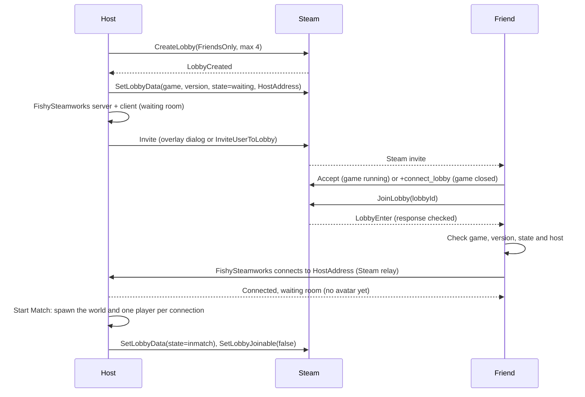

# Networking architecture (P2P and Steam)

Status: implemented. Local and LAN play over Tugboat work and are covered by tests. Steam co-op (friends-only lobbies, invites, joining through the Steam relay) is wired; it needs two Steam accounts, so I test it by hand (see [testing Steam](#6-testing-steam-between-two-pcs)).

---

## 1. How I handle the work

I build networking the same way as everything else in the project: small, focused pull requests into `main`, not one huge `feat/networking` branch.

| Approach | What I thought |
|---|---|
| One giant `feat/networking` branch | Weeks without merging. It conflicts badly with scene files and shaders, and a 5000-line diff is impossible to review. |
| An integration `epic/networking` branch | Only a fallback, if a slice cannot enter `main` without breaking it. |
| **Small PRs into `main`, grouped by milestone** | `main` stays playable, the history stays linear and I can deliver in steps. This is what I use. |

My rules:
1. Group the work in milestones (`v0.4.0 Networking`, `v0.5.0 Living Relics`, and so on), with a checklist of what "done" means for each.
2. Every PR uses the repository template, closes its issue (`Closes #N`) and is merged with a squash.
3. The offline fallback always works. The sandbox runs without any network.

---

## 2. Architecture

### Tech stack (all free to use)

| Component | Choice | Why |
|---|---|---|
| Netcode | **Fish-Net** | It supports Unity 6, performs well in client-host mode and has a clean prediction and reconciliation model. |
| Steam API | **Steamworks.NET** (MIT) | FishySteamworks depends on it. |
| Steam transport | **FishySteamworks** | A Fish-Net P2P transport that runs over Steam sockets. |
| Development transport | **Tugboat** (UDP) | Built into Fish-Net. It is fast to iterate on over localhost, and it is the LAN transport. |
| Transport switching | **Multipass** | Built into Fish-Net. Fish-Net initialises only the transport it starts with, so Multipass carries Tugboat and FishySteamworks, and the game picks one for each session. |
| Relay and NAT punchthrough | **Steam Datagram Relay** | Free with Steam. It gets through NAT without opening router ports and hides the host's IP. |
| Local testing | **Multiplayer Play Mode** | Simulates several players at once inside the Unity Editor. |

### Topology: client-host (listen server)

One player runs as both the server and a client. There are no dedicated server costs.

- **Host (server):** runs the enemy AI, the game rules, the relic states and the state of the world.
- **Clients:** are authoritative over their own movement and microphone capture.
- **Host migration:** not supported in v1. Like *Lethal Company* and *Phasmophobia*, if the host disconnects the session ends.

### Control plane (Steam lobby) and data plane (Fish-Net)

A Steam lobby is only used for discovery and for bringing players together: who is in, how many players there are and the host's address. Once the players are paired, Fish-Net carries the gameplay traffic.

### Who has authority over what

| Subsystem | Authority | Transport | Implementation |
|---|---|---|---|
| Player movement | Owning client | `NetworkTransform` with client authority | `PlayerController`, the camera and the input are only active on the owner. |
| Voice loudness | Owning client to server | `ServerRpc` with a quantized loudness (10 Hz) | The server feeds the loudness to `IVoiceLevelSource` for remote players. |
| Noise for the AI | Server | Evaluated on the server through `NoiseRegistry` | Remote avatars register their loudness in the server's `NoiseRegistry`. |
| Enemy AI | **Server** | Server-authoritative `NetworkTransform` | `NavMeshAgent` and `HearingSensor` are disabled on remote clients. |
| Ragdoll knockback | The server decides, the owner executes | Reliable `ObserversRpc` | `EnemyCatchReaction` calls `RpcTriggerRagdoll` on the victim. |
| Echo pulses | Replicated to all peers | Quantized `SyncVar<float>` and `EchoShaderPublisher` | Up to 4 spheres at once in `EchoReveal.shader`. |
| Relic pick-up and drop | Server | `SyncVar<NetworkObject>` for the carrier, plus a `ServerRpc` | `RelicCarryable`: the server checks the distance (5 m) and ignores relics that are already locked in the altar. |
| Relic dialogue | Server to observers | `ObserversRpc` | `RelicBrain` picks the line on the server. Clients only show it and play the voice. |
| Altar docking | Server | `ServerRequestDock` and a replicated mask of filled sockets (`SyncVar<int>`) | `AltarReceptacle` checks the carrier, the socket, the distance (6 m) and completion. `AltarRules` holds the rules. |
| Symphony and match flow | Server | Replicated state, countdown and end-screen quote (`SyncVar`) | `GameExtractionManager` (win, lose, restart) and `MatchRules`. A client that reaches the portal tells the server with `ServerRequestEscape`. |
| Restart | Server | `ServerRequestRestart` then `NetworkBootstrap.ServerRespawnWorld` | The relics and the monster are despawned and spawned again, and each player gets a `TargetRpc` to move back to a spawn point. |
| Voice chat | Proximity voice plugin | A separate voice channel | I will decide this in the audio polish phase. |

---

## 3. Implementation notes

- **Network rig:** all the multiplayer setup is one prefab, `Assets/Prefabs/Networking/NetworkRig.prefab` (`NetworkManager`, `TransportManager` with Multipass, Tugboat and FishySteamworks, `MatchPlayerSpawner`, Steam lobby support, `NetworkBootstrap`, `NetworkSession` and the menus). `NetworkRigBuilder` generates it (menu *Echo Protocol > Build > Network Rig Prefab*) and `NetworkRigInstaller` puts it into scenes, which the level builders call. The rig got lost once when I regenerated a scene. Now EditMode tests fail if the prefab is incomplete or if any scene in the build (except the offline `Sandbox_Test`, on purpose) is missing it.
- **Transports:** the rig's transport is Multipass with Tugboat and FishySteamworks. `GlobalServerActions` is off, so the server opens only the transport of the session (a Steam host does not also open a UDP port, and a local host does not need Steam); `NetworkBootstrap` starts and stops the server per transport, because `ServerManager.StartConnection` would ask Multipass for all of them. FishySteamworks runs peer to peer (a listen server on a player's Steam client) and accepts 4 players. Before this, the rig had only Tugboat and the bootstrap assigned another transport at runtime, which Fish-Net never initialises; that is why Steam co-op could not work.
- **Bootstrap:** `NetworkBootstrap` sets up the transports, the spawn points and the list of spawnable prefabs (Player, Enemy, Relic). Its API is `StartLocalHost`, `JoinLocalClient`, `StartSteamHost`, `JoinSteamHost`, `StartMatch` and `Disconnect`. The tests use it directly; the menus go through `NetworkSession`.
- **Waiting room:** the server opens a waiting room first. `MatchPlayerSpawner` (it replaces Fish-Net's `PlayerSpawner`) keeps connected players without an avatar until the host presses *Start Match*; then `StartMatch` spawns the monster, one relic per shrine and one player per connection at the level's spawn points. A LAN player who connects after the start spawns at once. A networked level contains no `Player` or `Enemy` of its own, because a copy in the scene would duplicate the spawned one.
- **Session:** `NetworkSession` is the flow from the player's side: Offline, creating a lobby, joining, connecting, waiting room, in match and error. It drives the bootstrap and the lobby, gives up on a join after 20 seconds, notices when the host leaves or the connection drops, and turns every failure into one sentence the player can act on. Only sessions it began report errors, so the tests and the launch flags stay quiet.
- **Steam lobbies:** `SteamLobbyManager` only talks to Steam. It creates friends-only lobbies (max 4) with the game id, the build version, the state and the host's SteamID (`HostAddress`). Joining checks Steam's answer (full, closed, banned...) and then `LobbyRules` checks the game, the version, whether the match has started and the host. It also sends invites (the overlay dialog or `InviteUserToLobby`), lists the lobby members, finds the lobbies friends are in (friends-only lobbies do not show in a lobby search), and closes the lobby when the match starts. Cancelling while Steam creates or joins a lobby leaves it.
- **Menus:** `LobbyMenuUI` (IMGUI, with the shared style in `EchoGui`) shows the main menu, the friends' games, the waiting screens with *Cancel*, the waiting room with players, invites and *Start Match*, the errors, and a small panel with *Leave Match* when the cursor is free during a match (press Esc).
- **Launch flags:** `-echo-host` hosts locally and starts the match at once, `-echo-join [address]` joins one, `+connect_lobby <id>` (added by Steam when an invite is accepted with the game closed) joins that lobby, and `-echo-no-steam` keeps the game away from the Steam client. `LaunchOptions` parses them and has unit tests. The serialized `Auto Start` field on the rig does the same as the first two without flags.
- **Steam shutdown:** Steamworks callbacks are disposed and the lobby is left in `OnDisable`. Touching `SteamManager.Initialized` from `OnDestroy` can create the manager again while the game is quitting.
- **SyncVar callbacks on the host:** a host gets `OnChange` twice (`asServer` true and false). Handlers that raise gameplay events (for example `RelicCarryable`) only process the server call on a host.
- **Microphone:** capture is reference counted (see [Architecture](ARCHITECTURE.md)), so remote avatars never open or close the local device.
- **Altar and match flow:** `AltarReceptacle` and `GameExtractionManager` are scene `NetworkObject`s. The server decides every docking, the symphony, the win or lose result and the restart, and the clients copy it through `SyncVar`s. FishNet keeps scene NetworkObjects inactive until a host or client starts, so the altar, the exit and the match manager only exist in `Dungeon_Main` during a session. Without a network (the sandbox), the same code runs locally: each state keeps a local copy, and only the server also writes the `SyncVar`s. The pure rules live in `AltarRules` and `MatchRules`, and the EditMode tests cover them.
- **Relics:** one living relic spawns for each shrine (the level's relic spawn points), with the personality of that shrine. The personality is replicated, so every peer speaks and sings with the same voice. A relic docked in the altar locks on every peer (`SyncVar<bool>`), and its position replicates through `NetworkTransform`.
- **Restart:** the server calls `NetworkBootstrap.ServerRespawnWorld()`. A scene reload would end the FishNet session, so I only use it offline.

## 4. Offline fallback

If a scene has no `NetworkManager` (today only `Sandbox_Test`), `OfflineSandboxGuard` marks the scene `NetworkObject`s as non-networked and binds every `NetworkBehaviour`, so the sandbox runs as a normal single-player scene (`IsSpawned` and `IsOwner` are `false`). Gameplay code therefore branches on `IsSpawned` and keeps a local path. The guard runs for the first scene and again on every later `sceneLoaded`, and it clears its offline flag when a networked scene loads.

`Dungeon_Main` is networked. Press Play and use the menu (*Host Local*, or *Join IP* from a second instance). To skip the menu and the waiting room, set `Auto Start` to *Host* on the rig prefab, or launch with `-echo-host`.

## 5. Current limitations

These are known gaps that I plan to fix in the networking pass of the release branch:

- **Steam is tested by hand.** The automated tests cover local play, the waiting room, the session flow and the lobby rules. Lobbies, invites and the Steam relay need two Steam accounts on two PCs (see the next section).
- **The Spacewar AppID (480).** Every developer who tests with Spacewar shares its lobbies, so mine are recognised by their data. Accepting an invite, or *Join Game* in the friends list, while the game is closed starts Spacewar, not Echo Protocol; `+connect_lobby` only helps once the game has its own AppID. With 480, start the game first and then accept the invite.
- **The Steam overlay** (*Shift+Tab*, and the *Invite* button) does not open in the Unity Editor. The in-game friends list works there.
- **No late join over Steam.** When the host starts the match, the lobby closes and friends see it as in progress. They join the next match. (A LAN player who connects mid-match spawns at once.)
- **Escaping is trusted.** The portal trigger runs on the owner's client, and the server accepts the report of a spawned player who says they reached the exit while the match is active. The server does not check their position yet.
- **The dock range is the only altar check.** The server checks that the player carries the relic, that the socket is free and that the player is within 6 m. It does not check line of sight or the interaction cooldown.
- **Sensing a remote carrier.** `RelicBrain` reads the carrier's sprint state from `PlayerController`, which only runs on the owner. For a remote carrier the server sees no sprint, so only the microphone and monster reactions work.
- **Remote ragdoll state.** The server cannot tell whether a remote player is ragdolling or immune (see [Enemy AI](ENEMY_AI.md#known-limitations)).
- **Debug keys** (`H`, `J`, `M`, `T`, `Y`, `N` and the debug ragdoll) only exist in the Editor and in Development builds. Most act locally; `N` (team noise) asks the server.
- **Team noise:** a `TeamNoiseDirector` prefab is spawned by the server with the monster and the relics, when the host starts the match. It replicates the meter and the alarm through `SyncVar`s. See [Team noise and push-to-talk echo](TEAM_NOISE.md).

## 6. Testing Steam between two PCs

Each PC needs its own Steam account, signed in, and the two accounts must be friends. Use the same build on both (menu *Echo Protocol > Build > Windows (Release)*), with `steam_appid.txt` next to the exe. Start the game before accepting any invite (see the AppID note above).

1. **Host.** On PC A click *Host Match*. Expect *Creating lobby*, then the waiting room with your name as host and three open slots.
2. **Invite from the game.** On PC A click *Friends* and *Invite* next to the account of PC B. Expect a Steam invite on PC B. Accept it while the game runs. Expect *Joining*, *Connecting*, then the waiting room on PC B with both names, and both names on PC A.
3. **Join from the list.** Instead of step 2, on PC B click *Join a Friend*. Expect PC A's game with *1/4 players*; click *Join*.
4. **Overlay invite.** On PC A click *Invite* (Shift+Tab overlay) and invite PC B. Same result as step 2.
5. **Start.** On PC A click *Start Match*. Both players spawn in the catacombs; PC B's lobby list now shows the game as in progress.
6. **Play.** Dock a relic on each PC, finish the symphony, escape. Both see the same altar, timer and result.
7. **Host leaves.** On PC A press Esc and *Leave Match*. Expect PC B to show an error (*The host left the match*, or *Lost the connection to the host*) with *Back to Menu*.
8. **Client leaves and comes back.** Host again, let PC B join, then PC B clicks *Leave*. PC A's waiting room shows the slot open again; PC B can join again.
9. **Errors.** Join a game whose host closed it (*That game no longer exists*). Use builds of two different versions (*The host runs version ...*). Quit Steam on one PC and start the game (*Steam is not running*; LAN still works).
