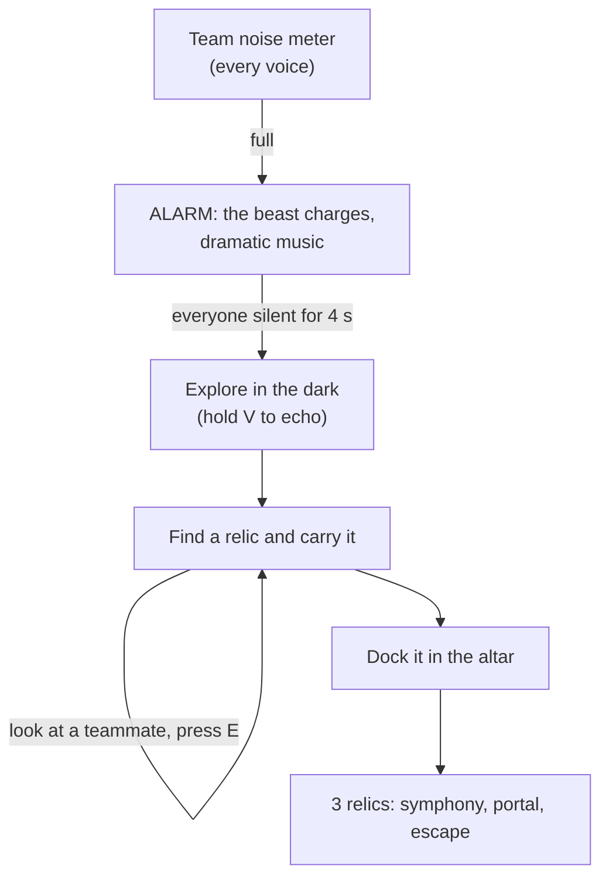

# Team noise and push-to-talk echo

This page explains the co-op layer on top of the relic and altar objective: push-to-talk echo, the shared team noise meter and passing a relic hand to hand. The objective stays simple, three relics in the altar and then the escape portal; this layer decides how much noise the team can make on the way.

---

## 1. The match, in one picture

## 2. Push-to-talk echo

- The voice only lights the cave while the player holds `V` (input action `Echo`, also the gamepad left shoulder). `EchoVisionController.TargetRadius(..., echoHeld)` returns 0 without the key.
- Talking without the key is plain voice chat: it reveals nothing.
- The monster still hears everything. `VoiceNoiseEmitter` weighs plain chat at 0.6 and an echo at 1.25, so seeing costs noise.
- The owner replicates whether it is echoing (`SyncVar<bool>`), so the server weighs remote voices correctly.
- With the default echo sensitivity (1.25, in the settings) a normal voice lights about 7 m, a raised voice about 11 m and a loud one much of the cavern.

## 3. Team noise meter

`TeamNoiseBudget` (pure, `Assets/Scripts/Core`) holds the rules; `TeamNoiseDirector` (`Assets/Scripts/TeamNoise`) runs them on the server.

| Rule | Default |
|---|---|
| Fill | every player's voice noise, times 0.07 per second. A player quieter than 0.15 adds nothing, so the hum of a room or a whisper never fills it |
| Drain | 0.04 per second while the summed noise is below 0.15 |
| Alarm | when the meter reaches 1 |
| End of the alarm | 4 seconds of total silence from the players; any voice restarts the count |

During the alarm:
- `EnemyBrain.AlarmAll` sends every monster charging at the loudest player at 7 m/s, and its hearing is 1.6 times sharper. It only starts to doubt once it reaches that spot, so silence still saves you.
- `TeamNoiseAudio` fades in a procedural alarm loop (kick drum, clashing stabs, a falling siren). Before the alarm, a low drone grows with the square of the meter. Both follow the *Ambience and music* volume setting.
- The HUD flashes "THE BEAST HEARD YOU! EVERYONE, STAY SILENT!" with a silence bar.

An enraged monster (the extraction climax) ignores the alarm: it is already hunting.

## 4. Passing a relic

While carrying a relic, look at a teammate within 3 m and press `E`. `RelicCarryable.ServerRequestPass` checks on the server that the caller holds the relic, that the receiver's hands are empty and that they stand close enough, then moves the carrier. The relic comments on the hand-off (`PassedAround` lines).

## 5. Debug key

`N` adds a chunk of team noise. It only exists in the Editor and in Development builds.

## 6. Files

| File | What it does |
|---|---|
| `Core/TeamNoiseBudget.cs` | Pure meter rules: fill, drain, alarm, calm |
| `TeamNoise/TeamNoiseDirector.cs` | Server: meter, alarm, replication |
| `TeamNoise/TeamNoiseHud.cs` | Meter, alarm and echo indicator |
| `TeamNoise/TeamNoiseAudio.cs` | Procedural tension drone and alarm music |
| `Editor/TeamNoisePrefabBuilder.cs` | Builds `Prefabs/TeamNoiseDirector.prefab` and wires it into the rig |

The networked server spawns the director prefab with the monster and the relics, and a restart respawns it, which empties the meter. The offline sandbox builds a local director from `GameExtractionManager`.

## 7. History

An earlier version also had sensitive relics that cried (when the carrier was loud, after a hard landing, or when nobody passed them around) and a "human echo ritual" to calm them, where players repeated a rhythm with their voice. Playtesting showed it did not work well and distracted from the objective, so it was removed: a relic is now simply carried to the altar.

## 8. What is not done yet

- Proximity voice chat. Plain chat is meant for coordinating, so the game needs it; today players talk over Discord or similar.
- The numbers above are first guesses and need tuning with real players.
