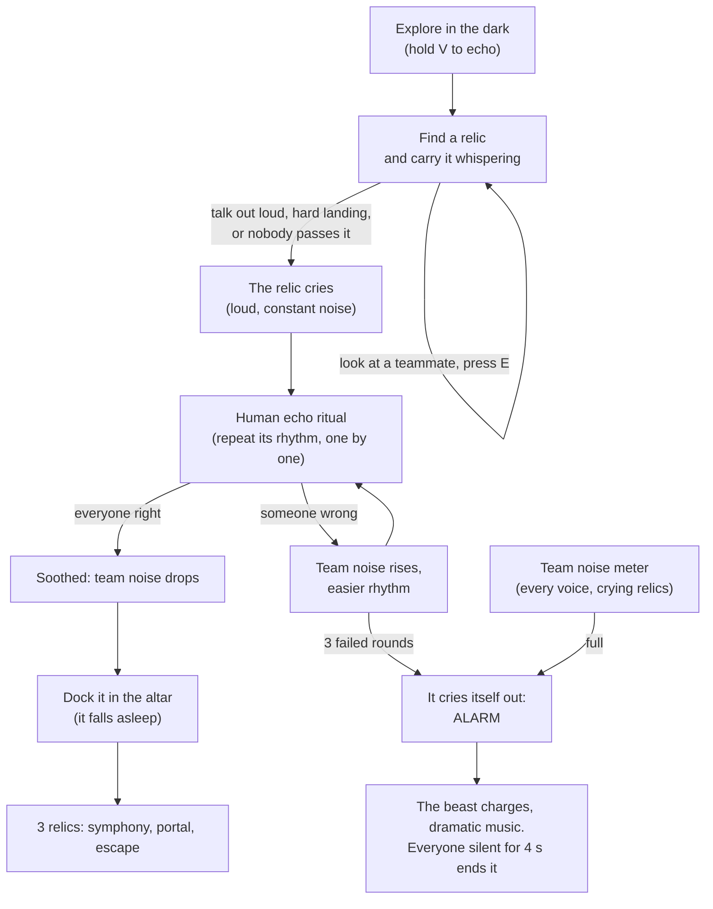

# Team noise and relic rituals

This page explains the co-op layer on top of the relic and altar objective: push-to-talk echo, the shared team noise meter, sensitive relics that cry, passing them hand to hand, and the human echo ritual that calms them. The goal is simple teamwork that is hard to coordinate, which is where the funny moments come from.

---

## 1. The match, in one picture

The objective does not change: three relics in the altar, then the escape portal. What changes is how hard it is to get them there.

## 2. Push-to-talk echo (implemented)

- The voice only lights the cave while the player holds `V` (input action `Echo`, also the gamepad left shoulder). `EchoVisionController.TargetRadius(..., echoHeld)` returns 0 without the key.
- Talking without the key is plain voice chat: it reveals nothing.
- The monster still hears everything. `VoiceNoiseEmitter` weighs plain chat at 0.6 and an echo at 1.25, so seeing costs noise.
- The owner replicates whether it is echoing (`SyncVar<bool>`), so the server weighs remote voices correctly.
- `V` no longer fakes a voice burst in debug builds.

## 3. Team noise meter (implemented)

`TeamNoiseBudget` (pure, `Assets/Scripts/Core`) holds the rules; `TeamNoiseDirector` (`Assets/Scripts/Rituals`) runs them on the server.

| Rule | Default |
|---|---|
| Fill | every player's voice noise, plus each crying relic at half weight, times 0.1 per second |
| Drain | 0.04 per second while the summed noise is below 0.06 |
| Alarm | when the meter reaches 1 |
| End of the alarm | 4 seconds of total silence from the players; any voice restarts the count. Crying relics do not count during the alarm, so a relic left crying far away cannot lock the team in it |
| A ritual right / wrong | -0.3 / +0.12 |

During the alarm:
- `EnemyBrain.AlarmAll` sends every monster charging at the loudest source at 7 m/s, and its hearing is 1.6 times sharper. It only starts to doubt once it reaches that spot, so silence still saves you.
- `TeamNoiseAudio` fades in a procedural alarm loop (kick drum, clashing stabs, a falling siren). Before the alarm, a low drone grows with the square of the meter.
- The HUD flashes "THE BEAST HEARD YOU! EVERYONE, STAY SILENT!" with a silence bar.

An enraged monster (the extraction climax) ignores the alarm: it is already hunting.

## 4. Sensitive relics (implemented)

`RelicTemper` (pure, `Assets/Scripts/Relics`) holds the mood rules; `RelicBrain` runs them on the server and replicates `IsCrying`.

- **Whisper while carrying.** A carrier voice at or above 0.3 (normal speech is about 0.35 after calibration) for 0.8 s makes it cry. A short shout is forgiven.
- **Pass it around.** With two or more players, one player can keep it for 35 s. At 70% it complains (`Fussy` line); at 100% it cries. A different player taking it (handed over or picked up from the floor) restarts the patience. Dropping it and picking it straight back up does not.
- **Hard landings hurt.** An impact at 7 m/s or more makes it cry.
- **Crying** is a constant 0.6 noise for the monster (it comes to investigate from about 25 m, and only hunts when it gets close), a looping procedural wail, and it fills the team meter. It stops chatting and roasting while it cries.
- **Docked in the altar** it falls asleep and stops crying.
- After being soothed it cannot cry again for 8 s.

New dialogue categories, with three lines per personality: `Crying`, `Soothed`, `Fussy`, `PassedAround`.

### Passing the baby

While carrying a relic, look at a teammate within 3 m and press `E`. `RelicCarryable.ServerRequestPass` checks on the server that the caller holds the relic, that the receiver's hands are empty and that they stand close enough, then moves the carrier. The giver's hands are cleared on their client.

## 5. The human echo ritual (implemented)

A crying relic plays a short rhythm, and the players near it repeat it one after the other with their voice.

1. **Call.** The server picks the first crying relic and up to four players within 16 m (the carrier first). It creates a pattern of 3 beats (`EchoRhythm.CreatePattern`), slower for Lord Malakor and faster for Nervous Nelly, and every peer hears the relic play it.
2. **Turns.** Each player gets the rhythm's length plus 1.7 s. Their own client listens: `VoiceOnsetDetector` reads the raw microphone level and marks the start of each syllable. The client sends the syllable times to the server as soon as it heard enough beats, or when the time runs out.
3. **Judging.** `EchoRhythm.Matches` compares the gaps between beats, not the words. The echo must have the same number of beats, may be up to 30% faster or 45% slower overall, and each beat may land 0.17 s off.
4. **Result.** Everyone right: the relic is soothed and the meter drops. Someone wrong: the round ends, the meter rises, and the next round uses one beat fewer (never fewer than 2). Three failed rounds: it cries itself out and the alarm starts.

### Why it is built this way

- **Any language.** Only loudness over time is measured, never speech, so "ba", "da" or "pato" all work.
- **Network delay does not matter.** Each player is timed on their own machine against their own first syllable, and only the result travels.
- **Precision.** The usual loudness is smoothed (it lingers about 170 ms), which blurs syllables together, so the detector reads `MicrophoneLoudness.RawLevel01` instead. A syllable ends when the level falls to 55% of its peak, so shouted syllables that never reach silence still split.
- **Not tiring.** A ritual only starts when a relic cries, which the players cause. Rhythms are 2 to 4 beats, a turn is about 2.5 s, a player who hears all the beats submits at once, and three failures end it.

## 6. Debug keys

`N` adds team noise, `B` makes the nearest relic cry. Both only exist in the Editor and in Development builds.

## 7. Files

| File | What it does |
|---|---|
| `Core/TeamNoiseBudget.cs` | Pure meter rules: fill, drain, alarm, calm |
| `Relics/RelicTemper.cs` | Pure mood rules: loud carrier, patience, grace |
| `Rituals/VoiceOnsetDetector.cs` | Pure syllable detection from a level stream |
| `Rituals/EchoRhythm.cs` | Pure rhythm patterns and matching |
| `Rituals/TeamNoiseDirector.cs` | Server: meter, alarm, ritual state machine, RPCs |
| `Rituals/TeamNoiseHud.cs` | Meter, alarm, ritual panel, echo indicator |
| `Rituals/TeamNoiseAudio.cs` | Procedural tension drone and alarm music |
| `Editor/TeamNoisePrefabBuilder.cs` | Builds `Prefabs/TeamNoiseDirector.prefab` and wires it into the rig |

The networked server spawns the director prefab with the monster and the relics, and a restart respawns it, which empties the meter. The offline sandbox builds a local director from `GameExtractionManager`.

## 8. What is not done yet

- Proximity voice chat. Plain chat is meant for coordinating, so the game needs it; today players talk over Discord or similar.
- The numbers above are first guesses and need tuning with real players.
- A player who joins during a ritual does not see it until the next round.
